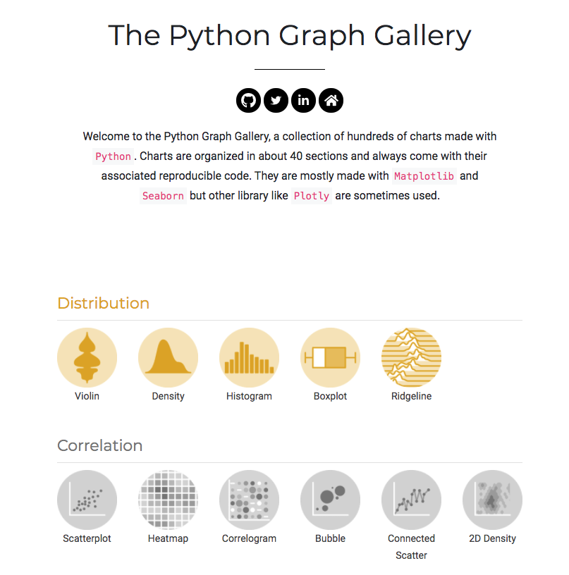

# The Python Graph Gallery.

This GitHub repository contains the source code for the [Python Graph Gallery](https://python-graph-gallery.com), a website showcasing hundreds of charts made with Python.

[Website](https://python-graph-gallery.com) | [About](https://python-graph-gallery.com/about) | [Contribute](#contributing)

<p align="center">
  
</p>

<br>
<br>

## Contributing

All kinds of contributions are welcome: from correcting a typo to adding a new blog post!

### Set Up Development Environment

The website is built with [Next.js](https://nextjs.org), [Tailwind CSS](https://tailwindcss.com) and [shadcn/ui](https://ui.shadcn.com). It is a static site hosted on GitHub Pages.

- Install Git and Node.js (v20 or later).
- Fork and clone the [GitHub repository](https://github.com/holtzy/The-Python-Graph-Gallery), then create a new Git branch.
- Run `npm install` to install dependencies.
- Run `npm run dev`, then visit `http://localhost:3000`.

### Improve a Blog Post

Each blog post is a folder in `content/posts/`, named after its url. To improve [`https://python-graph-gallery.com/20-basic-histogram-seaborn/`](https://python-graph-gallery.com/20-basic-histogram-seaborn/):

- Open `content/posts/20-basic-histogram-seaborn/index.md` in your code editor. It is plain markdown.
- Make your changes. If you change some code, regenerate the charts with `uv run python scripts/render_post.py 20-basic-histogram-seaborn`.
- Commit and push your changes, then open a pull request (PR). Tag **@holtzy** for a review.

### Create a Blog Post

- Duplicate an existing folder of `content/posts/`, e.g. `content/posts/1-basic-barplot/`.
- Rename it using lowercase letters and hyphens, starting with an unused number above 600.
  Example: `602-combine-boxplot-and-violintplot-using-seaborn`. This is the url of the post.
- Edit the frontmatter at the top of `index.md`:
  - `title`: appears as the main title.
  - `description`: short intro text under the title (HTML allowed).
  - `seoDescription`: plain-text description for meta tags. Think SEO!
  - `keywords`: for the HTML header.
  - `family`: one of **evolution**, **ranking**, **distribution**, **general**, **correlation**, **partOfAWhole**, **flow**, **map**.
  - `chartType`: must match an id of [`lib/sectionDescriptions.ts`](lib/sectionDescriptions.ts).
  - `slug`: the folder name.
- Write the post in markdown. Code goes in ` ```python ` blocks: readers can edit and run them in their browser!
- Run `uv run python scripts/render_post.py <slug>` to execute the code and create the chart images (`output-1.png`...).
- If the post needs a dataset, either use a stable url (e.g. a file on GitHub) or put the csv file next to `index.md`.
- Preview the post at `http://localhost:3000/<slug>/`.

#### Add Links to Blog Post

1. **Create a Screenshot**

   - Take a screenshot of the plot (on Mac: `ctrl + cmd + 4`).
   - Ensure it's square and at least 480x480 px.
   - Move the file to `static/graph/`, named like the post, e.g. `602-combine-boxplot-and-violintplot-using-seaborn.png`.
   - For multiple images: `-1.png`, `-2.png`, etc.

2. **Update Section Page**

   - If your post features a violin chart, update `app/violin-plot/page.tsx`.
   - Add:

   ```tsx
   <ChartImageContainer
     imgName="602-combine-boxplot-and-violintplot-using-seaborn"
     caption="Combine boxplot and violinplot with seaborn"
     linkTo="/602-combine-boxplot-and-violintplot-using-seaborn"
   />
   ```

#### Push Your Changes

Before pushing, review the [New Post Checklist](https://github.com/holtzy/The-Python-Graph-Gallery/wiki/New-post-check-list).

Once everything is ready, commit, push, and open a pull request on Github.

**Congrats! 🎉**

### Deploy

`npm run deploy` builds the site and publishes the `out/` folder to the `gh-pages` branch. Before deploying a big change, `npm run seo-diff -- <folder-of-the-previous-build>` checks that urls, titles, descriptions, headings and links are unchanged.
