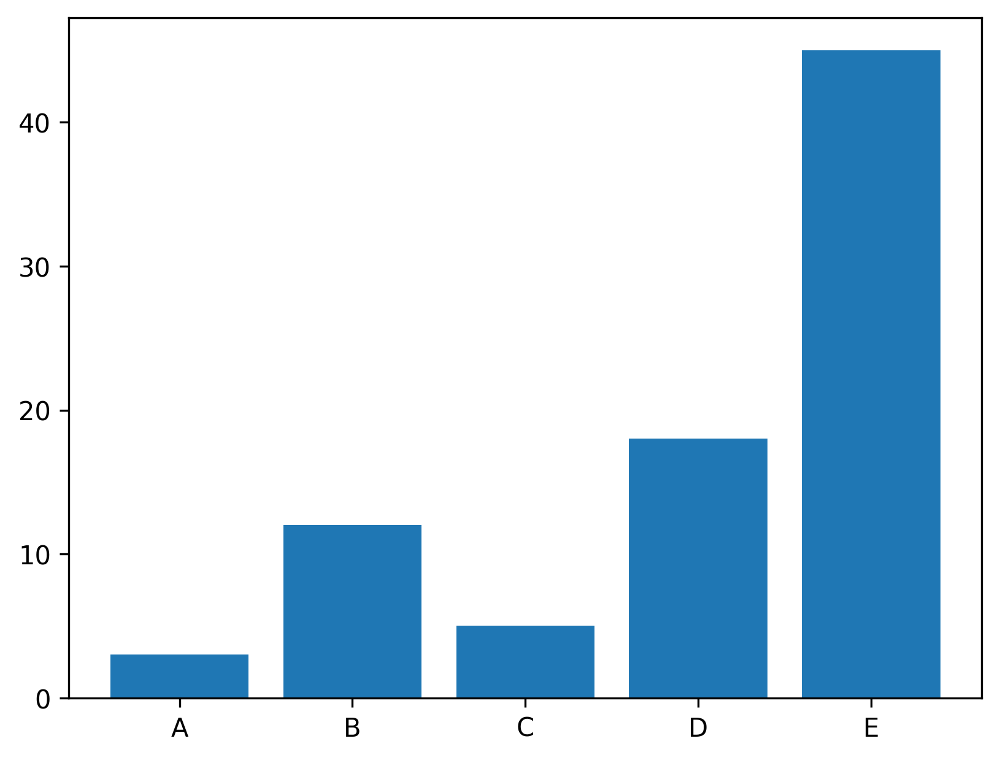

## Libraries & Dataset

A [barplot](https://www.data-to-viz.com/graph/barplot.html) shows the relationship between a **numeric** and a **categoric** variable.

Let's load the `numpy` and `matplotlib` libraries that are necessary to build a barplot. If you're not familiar with `matplotlib` yet, it is the most widespread library for dataviz in python, and the gallery has a [dedicated section](https://python-graph-gallery.com/matplotlib/) on it.

Then, let's build a small dataset.

```python
# Libraries
import numpy as np
import matplotlib.pyplot as plt

# Create dataset
height = [3, 12, 5, 18, 45]
bars = ('A', 'B', 'C', 'D', 'E')
x_pos = np.arange(len(bars))
```

## Basic barplot

This example shows probably the most basic [barplot](http://python-graph-gallery.com/barplot/) you can do with python and [matplotlib](http://python-graph-gallery.com/matplotlib/). The `bar()` function used with the following parameters:

- `x` : The x coordinates of the bars. (x_pos in the example)
- `height` : The height(s) of the bars.

```python
# Create bars
plt.bar(x_pos, height)

# Create names on the x-axis
plt.xticks(x_pos, bars)

# Show graphic
plt.show()
```

:::output

:::

## Going further

This post explains how to create a basic [barplot](https://python-graph-gallery.com/barplot/) using [matplotlib](https://python-graph-gallery.com/matplotlib/)!

For more examples of **how to create or customize** your barplots, see the [barplot section](https://python-graph-gallery.com/barplot/). You may also be interested in how to [custom colors in a barplot](https://python-graph-gallery.com/3-control-color-of-barplots/).
