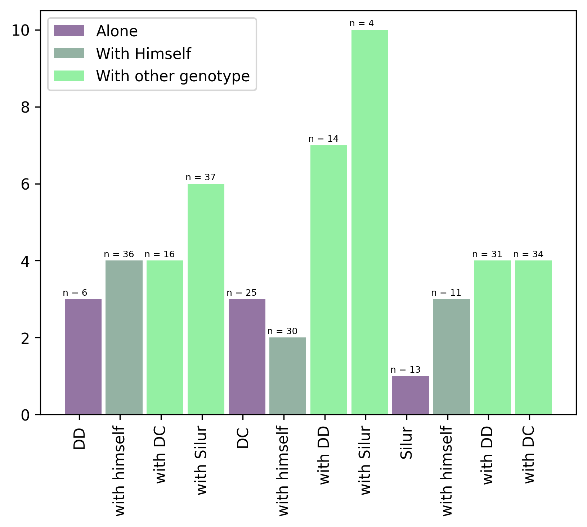

The following example shows how to display the number of observation per group on a barplot. `bar()` function of matplotlib is used to draw barplot with the following arguments:

- `x` : The x coordinates of the bars.
- `height` : The height(s) of the bars.
- `width` : The width(s) of the bars.
- `color` : The colors of the bar faces.
- `label` : The labels of the bars.

Note that, `legend()` function is used to add a legend, `xticks()` function is used to add labels of bars to the x axis, and `text()` function is used to add text on the top of each bar.

If you need to add the number of observation on top of each bar, it means that you have **several observation per group**. In this case, barplot is probably not the most appropriate method for visualising your data! Indeed, all the information behind each bar is **lost**.

You should probably try to use a [violin plot](http://python-graph-gallery.com/violin-plot/) or a [boxplot](http://python-graph-gallery.com/boxplot/). Another solution can be to add [error bars](http://python-graph-gallery.com/8-add-confidence-interval-on-barplot/) at the top of each bar.

```python
# library
import matplotlib.pyplot as plt
 
# Create bars
barWidth = 0.9
bars1 = [3, 3, 1]
bars2 = [4, 2, 3]
bars3 = [4, 6, 7, 10, 4, 4]
bars4 = bars1 + bars2 + bars3
 
# The X position of bars
r1 = [1,5,9]
r2 = [2,6,10]
r3 = [3,4,7,8,11,12]
r4 = r1 + r2 + r3
 
# Create barplot
plt.bar(r1, bars1, width = barWidth, color = (0.3,0.1,0.4,0.6), label='Alone')
plt.bar(r2, bars2, width = barWidth, color = (0.3,0.5,0.4,0.6), label='With Himself')
plt.bar(r3, bars3, width = barWidth, color = (0.3,0.9,0.4,0.6), label='With other genotype')
# Note: the barplot could be created easily. See the barplot section for other examples.
 
# Create legend
plt.legend()
 
# Text below each barplot with a rotation at 90°
plt.xticks([r + barWidth for r in range(len(r4))], ['DD', 'with himself', 'with DC', 'with Silur', 'DC', 'with himself', 'with DD', 'with Silur', 'Silur', 'with himself', 'with DD', 'with DC'], rotation=90)
 
# Create labels
label = ['n = 6', 'n = 25', 'n = 13', 'n = 36', 'n = 30', 'n = 11', 'n = 16', 'n = 37', 'n = 14', 'n = 4', 'n = 31', 'n = 34']
 
# Text on the top of each bar
for i in range(len(r4)):
    plt.text(x = r4[i]-0.5 , y = bars4[i]+0.1, s = label[i], size = 6)

# Adjust the margins
plt.subplots_adjust(bottom= 0.2, top = 0.98)
 
# Show graphic
plt.show()
```

:::output

:::
