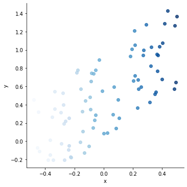
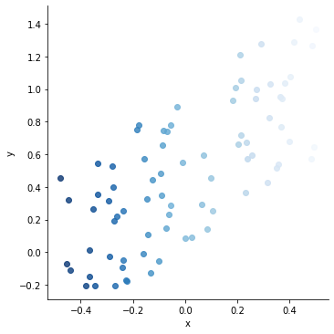
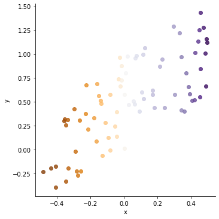
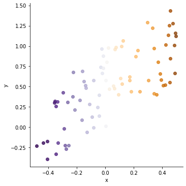
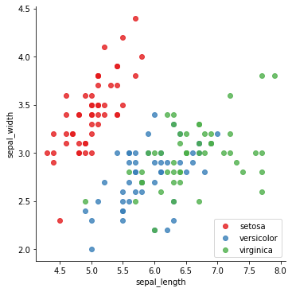
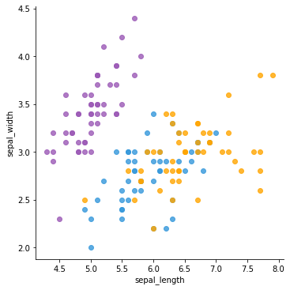

You can choose color palettes in [seaborn](http://python-graph-gallery.com/seaborn/) plots. There are 3 categories of color palettes: sequential, discrete and diverging. You can find explanations and examples for each category in the following sections.

## Sequential

**Sequential** color palettes are appropriate when you are mapping values from relatively low to high or from high to low. In order to set the colors move from lighther to darker in a sequential color palette, you should give `palette` parameter in your plot function. If you want the reverse order of colors (darker to lighter), you can simply add the suffix "_r" to color of your choice.

```python
# Libraries
import seaborn as sns
import matplotlib.pyplot as plt
import numpy as np
import pandas as pd
 
# create data
x = np.random.rand(80) - 0.5
y = x+np.random.rand(80)
z = x+np.random.rand(80)
df = pd.DataFrame({'x':x, 'y':y, 'z':z})
 
# Plot with palette
sns.lmplot( x='x', y='y', data=df, fit_reg=False, hue='x', legend=False, palette="Blues")
plt.show()
 
# reverse palette
sns.lmplot( x='x', y='y', data=df, fit_reg=False, hue='x', legend=False, palette="Blues_r")
plt.show()
```

:::output



:::

## Diverging

**Diverging** color palettes are appropriate when you equally important high and low values in your dataset. Diverging colors are composed of 2 contrast colors, darker on the edges and lighther in the center. You can use reverse colors by adding the suffix "_r" to color of your choice.

```python
# Libraries
import seaborn as sns
import matplotlib.pyplot as plt
import numpy as np
import pandas as pd
 
# create data
x = np.random.rand(80) - 0.5
y = x+np.random.rand(80)
z = x+np.random.rand(80)
df = pd.DataFrame({'x':x, 'y':y, 'z':z})
 
# plot
sns.lmplot( x='x', y='y', data=df, fit_reg=False, hue='x', legend=False, palette="PuOr")
plt.show()

# reverse palette
sns.lmplot( x='x', y='y', data=df, fit_reg=False, hue='x', legend=False, palette="PuOr_r")
plt.show()
```

:::output



:::

## Discrete

You can control the colors using `set_palette()` function of seaborn. It is possible to give a list of colors you want to use in your plots as a parameter to set_palette function.

```python
# library & dataset
import seaborn as sns
import matplotlib.pyplot as plt
df = sns.load_dataset('iris')
 
# use the 'palette' argument of seaborn
sns.lmplot( x="sepal_length", y="sepal_width", data=df, fit_reg=False, hue='species', legend=False, palette="Set1")
plt.legend(loc='lower right')
plt.show()
 
# use a handmade palette
flatui = ["#9b59b6", "#3498db", "orange"]
sns.set_palette(flatui)
sns.lmplot( x="sepal_length", y="sepal_width", data=df, fit_reg=False, hue='species', legend=False)
plt.show()
```

:::output



:::
