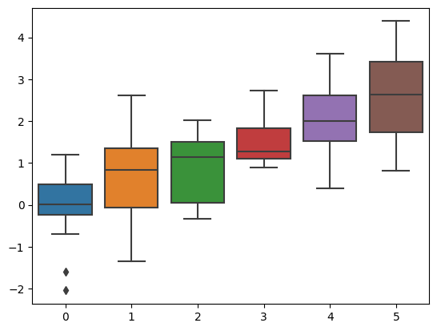
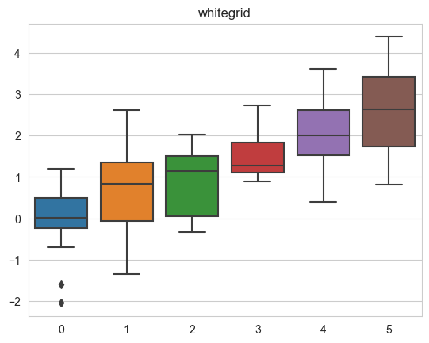
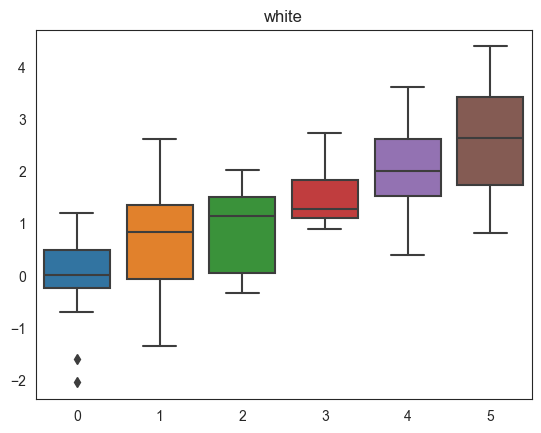
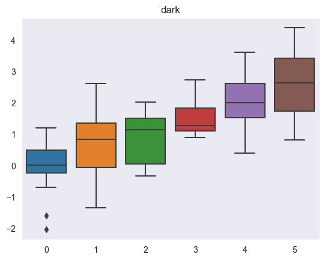
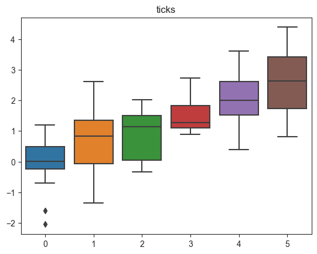

## Libraries

Let's start by loading a few libraries:

- [matplotlib](https://python-graph-gallery.com/matplotlib/): for plotting
- [seaborn](https://python-graph-gallery.com/seaborn/): for the themes
- `numpy` for data generation
- `pandas` for storing the data

```python
import matplotlib.pyplot as plt
import seaborn as sns
import numpy as np
import pandas as pd
```

## Dataset

Our dataset will consist of 6 columns of numeric values:

```python
data = np.random.normal(size=(20, 6)) + np.arange(6) / 2
df = pd.DataFrame(data)
df.head()
```

:::output
::output-html{src="./output-1.html"}
:::

## Default theme

```python
sns.boxplot(data=data)
plt.show()
```

:::output

:::

## White grid

```python
sns.set_style("whitegrid")
sns.boxplot(data=data)
plt.title("whitegrid")
plt.show()
```

:::output

:::

## Dark grid

```python
sns.set_style("darkgrid")
sns.boxplot(data=data);
plt.title("darkgrid")
plt.show()
```

:::output

:::

## White

```python
sns.set_style("white")
sns.boxplot(data=data);
plt.title("white")
plt.show()
```

:::output

:::

## Dark

```python
sns.set_style("dark")
sns.boxplot(data=data);
plt.title("dark")
plt.show()
```

:::output

:::

## Ticks

```python
sns.set_style("ticks")
sns.boxplot(data=data);
plt.title("ticks")
plt.show()
```

:::output

:::

## Going further

This post explains how to set the style of a [seaborn](https://python-graph-gallery.com/seaborn/) plot.

You might be interested in how to [custom axis in seaborn](https://python-graph-gallery.com/191-custom-axis-on-matplotlib-chart/) and how to [add a title in seaborn](https://python-graph-gallery.com/seaborn-title-customization/)
