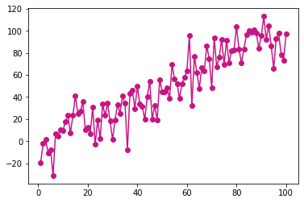
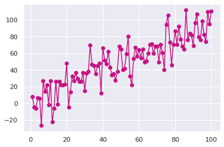

[Matplotlib](https://python-graph-gallery.com/matplotlib/) allows you to make absolutely any type of chart. However the chart **style** of matplotlib library is not as fancy as seaborn style. It is possible to benefit from [seaborn](https://python-graph-gallery.com/seaborn/) library style when plotting charts in matplotlib. You just need to load the seaborn library and use seaborn `set_theme()` function!

```python
# library and dataset
from matplotlib import pyplot as plt
import pandas as pd
import numpy as np
 
# Create data
df=pd.DataFrame({'x_axis': range(1,101), 'y_axis': np.random.randn(100)*15+range(1,101), 'z': (np.random.randn(100)*15+range(1,101))*2 })
 
# plot with matplotlib
plt.plot( 'x_axis', 'y_axis', data=df, marker='o', color='mediumvioletred')
plt.show()
```

:::output

:::

```python
# library and dataset
from matplotlib import pyplot as plt
import pandas as pd
import numpy as np
 
# Create data
df=pd.DataFrame({'x_axis': range(1,101), 'y_axis': np.random.randn(100)*15+range(1,101), 'z': (np.random.randn(100)*15+range(1,101))*2 })

# Just load seaborn & set theme and the chart looks better:
import seaborn as sns
sns.set_theme()

# Plot
plt.plot( 'x_axis', 'y_axis', data=df, marker='o', color='mediumvioletred')
plt.show()
```

:::output

:::
