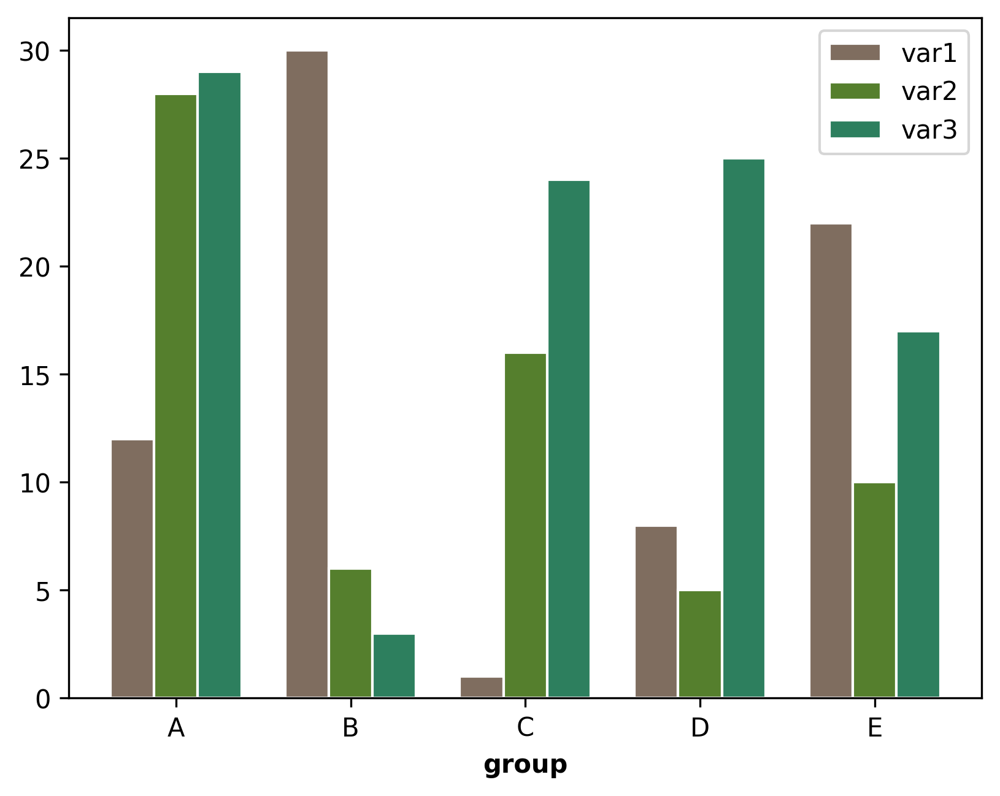

## Grouped barplot

You can plot a grouped barplot using the `bar()` function of [matplotlib](/matplotlib). The following example displays **5 different groups with their 3 variables**. In order to do that, the values and positions of variables are passed to 3 `bar()` functions.

Note that if you want to turn the graph into a stacked area barplot, you can check the [following post](http://python-graph-gallery.com/12-stacked-barplot-with-matplotlib/).

```python
import numpy as np
import matplotlib.pyplot as plt

# Data
barWidth = 0.25
bars1 = [12, 30, 1, 8, 22]
bars2 = [28, 6, 16, 5, 10]
bars3 = [29, 3, 24, 25, 17]

# Bar positions
r = np.arange(len(bars1))
r2 = r + barWidth
r3 = r2 + barWidth

# Plotting
fig, ax = plt.subplots(dpi=300)
ax.bar(r, bars1, color='#7f6d5f', width=barWidth, edgecolor='white', label='var1')
ax.bar(r2, bars2, color='#557f2d', width=barWidth, edgecolor='white', label='var2')
ax.bar(r3, bars3, color='#2d7f5e', width=barWidth, edgecolor='white', label='var3')

# Xticks
ax.set_xlabel('group', fontweight='bold')
ax.set_xticks(r + barWidth)
ax.set_xticklabels(['A', 'B', 'C', 'D', 'E'])

# Legend and show
ax.legend()
plt.show()
```

:::output

:::

## Going further

You might be interested in:

- [add hatchs/patterns to a barplot](/584-introduction-hatch-matplotlib)
- [transform a barplot into a tornado chart](/web-tornado-chart)
- [add annotation in a barplot](/10-barplot-with-number-of-observation)
