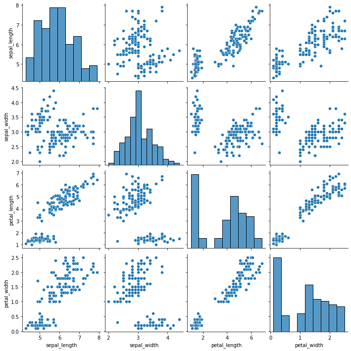

[Seaborn](https://python-graph-gallery.com/seaborn/) allows you to make a [correlogram](https://python-graph-gallery.com/correlogram/) or correlation matrix really easily. Correlogram is awesome for **exploratory analysis**: it makes you quickly observe the relationship between every variable of your matrix. It is easy to do it with seaborn: just call the `pairplot()` function!

```python
# libraries
import seaborn as sns
import matplotlib.pyplot as plt

# load data set
df = sns.load_dataset('iris')

# Basic correlogram
sns.pairplot(df)
plt.show()
```

:::output

:::
