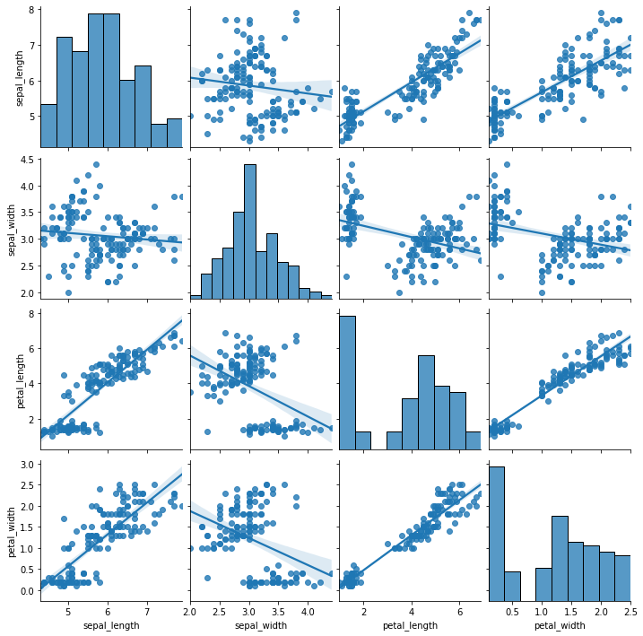
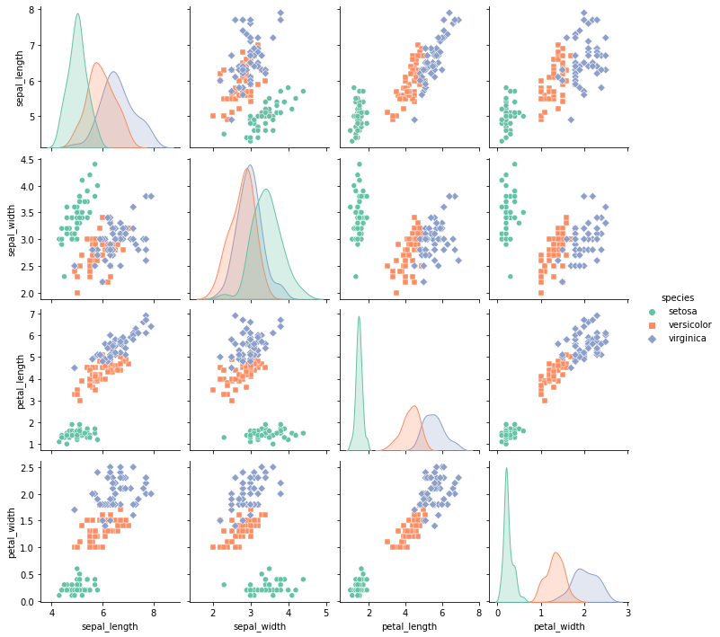
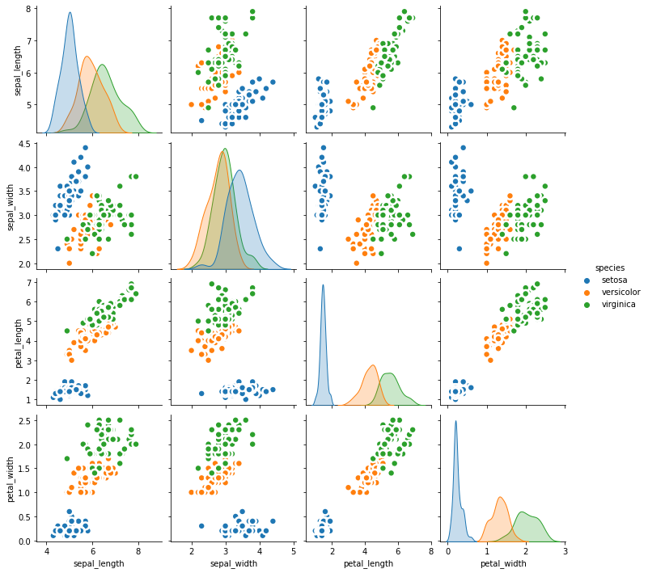
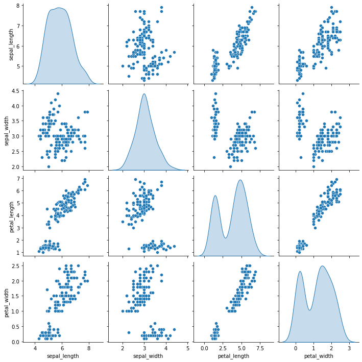
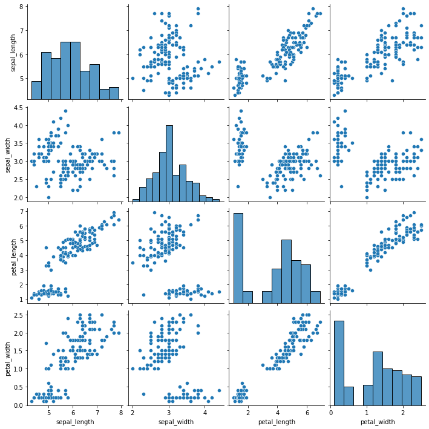
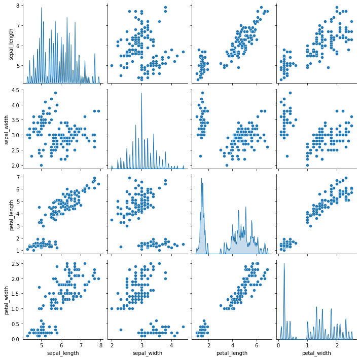

The previous [post](https://python-graph-gallery.com/110-basic-correlation-matrix-with-seaborn/) shows how to make a basic [correlogram](https://python-graph-gallery.com/correlogram/) with [seaborn](https://python-graph-gallery.com/seaborn/). This post aims to explain how to improve it. It is divided in 2 parts: how to custom the **correlation** observation (for each pair of numeric variable), and how to custom the **distribution** (diagonal of the matrix).

## Correlation

The seaborn library allows to draw a correlation matrix through the `pairplot()` function. The parameters to create the example graphs are:
* `data` : dataframe
* `kind` : kind of plot to make (possible kinds are ‘scatter’, ‘kde’, ‘hist’, ‘reg’)

```python
# library & dataset
import matplotlib.pyplot as plt
import seaborn as sns
df = sns.load_dataset('iris')
 
# with regression
sns.pairplot(df, kind="reg")
plt.show()
 
# without regression
sns.pairplot(df, kind="scatter")
plt.show()
```

:::output



:::

In a graph drawn by `pairplot()` function of seaborn, you can control the marker features, colors and data groups by using additional parameters such as:
* `hue` : variables that define subsets of the data
* `markers` : a list of marker shapes
* `palette` : set of colors for mapping the hue variable 
* `plot_kws` : a dictionary of keyword arguments to modificate the plot

```python
# library & dataset
import matplotlib.pyplot as plt
import seaborn as sns
df = sns.load_dataset('iris')
 
# left
sns.pairplot(df, kind="scatter", hue="species", markers=["o", "s", "D"], palette="Set2")
plt.show()
 
# right: you can give other arguments with plot_kws.
sns.pairplot(df, kind="scatter", hue="species", plot_kws=dict(s=80, edgecolor="white", linewidth=2.5))
plt.show()
```

:::output



:::

## Distribution

As you can select the kind of plot to make in `pairplot()` function, you can also select the kind of plot for the diagonal subplots. 
* `diag_kind` : the kind of plot for the diagonal subplots  (possible kinds are ‘auto’, ‘hist’, ‘kde’, None)  

Note that you can use `bw_adjust` to increase or decrease the amount of smoothing.

```python
# library & dataset
import seaborn as sns
import matplotlib.pyplot as plt
df = sns.load_dataset('iris')
 
# Density
sns.pairplot(df, diag_kind="kde")
 
# Histogram
sns.pairplot(df, diag_kind="hist")
 
# You can custom it as a density plot or histogram so see the related sections
sns.pairplot(df, diag_kind="kde", diag_kws=dict(shade=True, bw_adjust=.05, vertical=False) )

plt.show()
```

:::output





:::
