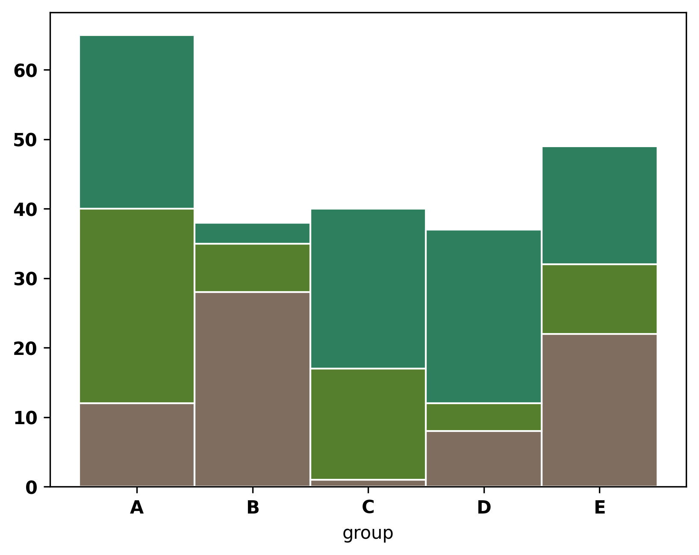

In a **stacked barplot**, subgroups are displayed on top of each other. The code is very similar with the previous post [#11-grouped barplot](https://python-graph-gallery.com/11-grouped-barplot/). Instead of passing different x axis positions to the function, you will pass the same positions for each variable. Additionally, in order to draw bars on top of each other, you should use `bottom` parameter of the `bar()` function. This parameter will set the bottom value (bottom line) of the bar.

In the following post [#13](https://python-graph-gallery.com/13-percent-stacked-barplot/), you can see how to turn this graph into a stacked percent barplot easily.

```python
# libraries
import numpy as np
import matplotlib.pyplot as plt
from matplotlib import rc
import pandas as pd
 
# y-axis in bold
rc('font', weight='bold')
 
# Values of each group
bars1 = [12, 28, 1, 8, 22]
bars2 = [28, 7, 16, 4, 10]
bars3 = [25, 3, 23, 25, 17]
 
# Heights of bars1 + bars2
bars = np.add(bars1, bars2).tolist()
 
# The position of the bars on the x-axis
r = [0,1,2,3,4]
 
# Names of group and bar width
names = ['A','B','C','D','E']
barWidth = 1
 
# Create brown bars
plt.bar(r, bars1, color='#7f6d5f', edgecolor='white', width=barWidth)
# Create green bars (middle), on top of the first ones
plt.bar(r, bars2, bottom=bars1, color='#557f2d', edgecolor='white', width=barWidth)
# Create green bars (top)
plt.bar(r, bars3, bottom=bars, color='#2d7f5e', edgecolor='white', width=barWidth)
 
# Custom X axis
plt.xticks(r, names, fontweight='bold')
plt.xlabel("group")
 
# Show graphic
plt.show()
```

:::output

:::
