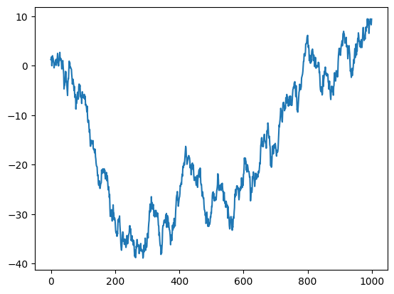
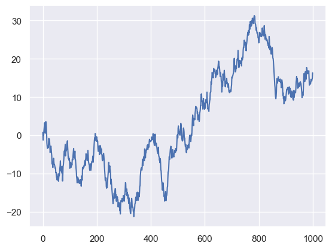
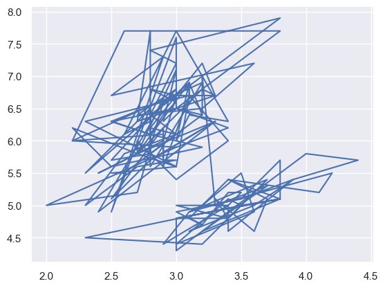
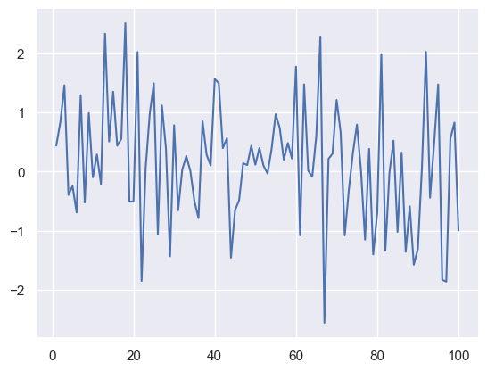

## Libraries

First, we need to load a few libraries:

- [matplotlib](https://python-graph-gallery.com/matplotlib/): for creating/styling the plot
- [seaborn](https://python-graph-gallery.com/seaborn/): for creating the plot
- `numpy` for data generation

```python
import matplotlib.pyplot as plt
import seaborn as sns
import numpy as np
```

## Basic Lineplot

You can create a **basic line chart** with the `plot()` function of matplotlib library.  If you give only a serie of values, matplotlib will consider that these values are ordered and will use values from 1 to n to create the X axis (figure 1):

```python
# create data
values=np.cumsum(np.random.randn(1000,1))
 
# use the plot function
plt.plot(values)

# show the graph
plt.show()
```

:::output

:::

## Seaborn Customization

For a more trendy look, you can use the `set_theme()` function of seaborn library. You will automatically get the look of figure 2.

```python
sns.set_theme()

# create data
values=np.cumsum(np.random.randn(1000,1))
 
# use the plot function
plt.plot(values)

# show the graph
plt.show()
```

:::output

:::

## Use lineplot with unordered data

You can also make a line chart from 2 series of values (X and Y axis). However, make sure that your X axis values are ordered! If not, you will get this kind of figure (figure 3).

```python
# import the iris dataset
df = sns.load_dataset('iris')
 
# plot
plt.plot( 'sepal_width', 'sepal_length', data=df)

# show the graph
plt.show()
```

:::output

:::

## Use lineplot with ordered data

If your X data is ordered, then you will get a similar figure as figure 1:

```python
import pandas as pd
df=pd.DataFrame({'xvalues': range(1,101), 'yvalues': np.random.randn(100) })
 
# plot
plt.plot( 'xvalues', 'yvalues', data=df)

# show the graph
plt.show()
```

:::output

:::

## Going further

This post explains how to customize a [line plot](https://python-graph-gallery.com/line-chart/) with matplotlib and seaborn libraries.

You might be interested in how to [use 2 different y axis for 2 lines](https://python-graph-gallery.com/line-chart-dual-y-axis-with-matplotlib/) and how to [have a log scale](https://python-graph-gallery.com/525-line-chart-log-transform/).
