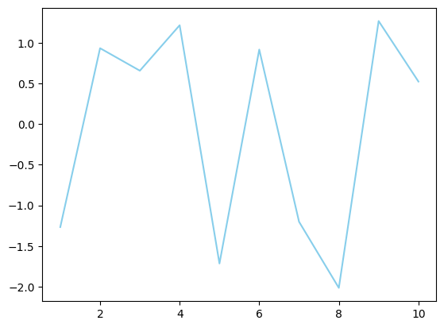
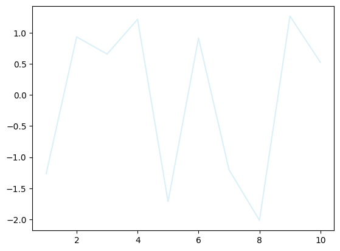
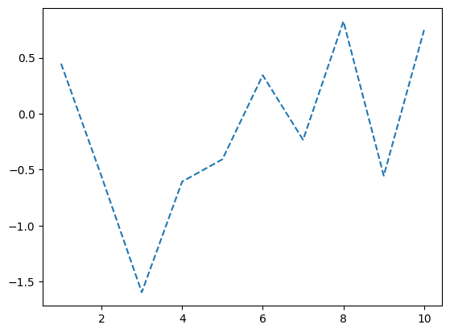
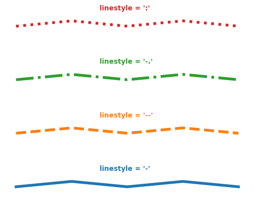
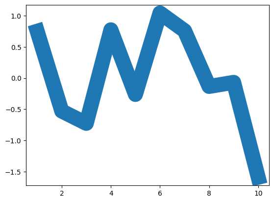

## Libraries

First, we need to load a few libraries:

- [matplotlib](https://python-graph-gallery.com/matplotlib/): for creating/styling the plot
- [pandas](https://python-graph-gallery.com/pandas/): for data manipulation
- `numpy` for data generation

```python
import matplotlib.pyplot as plt
import pandas as pd
import numpy as np
```

## Custom Line Color

To custom color, just use the `color` argument!  

Note that you can add **transparency** to the color with the `alpha` argument (0=transparent, 1=opaque).

```python
df=pd.DataFrame({'x_values': range(1,11), 'y_values': np.random.randn(10) })

# Draw plot
plt.plot( 'x_values', 'y_values', data=df, color='skyblue')
plt.show()

# Draw line chart by modifiying transparency of the line
plt.plot( 'x_values', 'y_values', data=df, color='skyblue', alpha=0.3)

# Show plot
plt.show()
```

:::output



:::

## Custom Line Style

You can choose between different **line styles** with the `linestyle` argument.

```python
df = pd.DataFrame({'x_values': range(1,11), 'y_values': np.random.randn(10) })

# Draw line chart with dashed line
plt.plot( 'x_values', 'y_values', data=df, linestyle='dashed')

# Show graph
plt.show()
```

:::output

:::

The following examples show different types of line styles.

```python
plt.plot( [1,1.1,1,1.1,1], linestyle='-' , linewidth=4)
plt.text(1.5, 1.3, "linestyle = '-' ", horizontalalignment='left', size='medium', color='C0', weight='semibold')
plt.plot( [2,2.1,2,2.1,2], linestyle='--' , linewidth=4 )
plt.text(1.5, 2.3, "linestyle = '--' ", horizontalalignment='left', size='medium', color='C1', weight='semibold')
plt.plot( [3,3.1,3,3.1,3], linestyle='-.' , linewidth=4 )
plt.text(1.5, 3.3, "linestyle = '-.' ", horizontalalignment='left', size='medium', color='C2', weight='semibold')
plt.plot( [4,4.1,4,4.1,4], linestyle=':' , linewidth=4 )
plt.text(1.5, 4.3, "linestyle = ':' ", horizontalalignment='left', size='medium', color='C3', weight='semibold')
plt.axis('off')
plt.show()
```

:::output

:::

## Custom Line Width

Finally you can custom the **line width** as well using `linewidth` argument.

```python
# Libraries and data
import matplotlib.pyplot as plt
import numpy as np
import pandas as pd
df=pd.DataFrame({'x_values': range(1,11), 'y_values': np.random.randn(10) })

# Modify line width of the graph
plt.plot( 'x_values', 'y_values', data=df, linewidth=22)

# Show graph
plt.show()
```

:::output

:::

## Going further

This post explains how to customize a the line of a [line chart](https://python-graph-gallery.com/line-chart/) with matplotlib.

You might be interested in how to [use 2 different y axis for 2 lines](https://python-graph-gallery.com/line-chart-dual-y-axis-with-matplotlib/) and how to [have a log scale](https://python-graph-gallery.com/525-line-chart-log-transform/).
