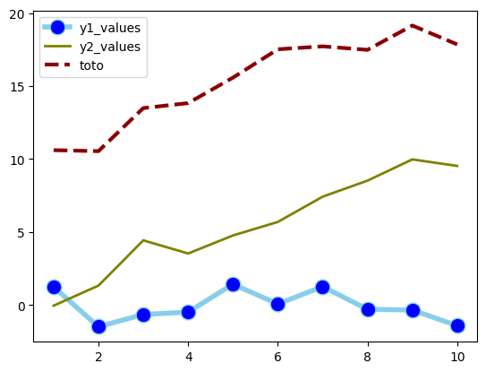

## Libraries

First, we need to load a few libraries:

- [matplotlib](https://python-graph-gallery.com/matplotlib/): for creating/styling the plot
- [pandas](https://python-graph-gallery.com/pandas/): for data manipulation
- `numpy` for data generation

```python
import matplotlib.pyplot as plt
import pandas as pd
import numpy as np
```

## Dataset

Let's create **4 simple columns** created with `numpy` that we put in a `pandas` dataframe.

```python
df = pd.DataFrame({
    'x_values': range(1,11),
    'y1_values': np.random.randn(10),
    'y2_values': np.random.randn(10)+range(1,11),
    'y3_values': np.random.randn(10)+range(11,21)
    }
)
```

## Mutliple line charts

Here we display 3 different line charts with **different style properties**:

```python
plt.plot(
    'x_values', 'y1_values', data=df,
    marker='o', # marker type
    markerfacecolor='blue', # color of marker
    markersize=12, # size of marker
    color='skyblue', # color of line
    linewidth=4 # change width of line
)

plt.plot(
    'x_values', 'y2_values', data=df,
    marker='', # no marker
    color='olive', # color of line
    linewidth=2 # change width of line
)

plt.plot(
    'x_values', 'y3_values', data=df,
    marker='', # no marker
    color='darkred', # color of line
    linewidth=3, # change width of line
    linestyle='dashed', # change type of line
    label="toto" # label for legend
)

# show legend
plt.legend()

# show graph
plt.show()
```

:::output

:::

## Going further

This post explains how to customize a the line of a [line chart](https://python-graph-gallery.com/line-chart/) with matplotlib.

You might be interested in a more [advanced line chart customization](https://python-graph-gallery.com/123-highlight-a-line-in-line-plot/) and how to [have a log scale](https://python-graph-gallery.com/525-line-chart-log-transform/).
