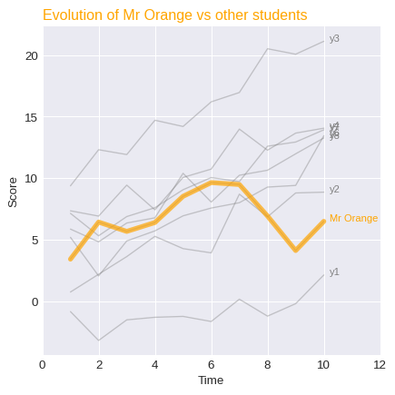

The trick for **highlighting a specific group** is to plot all the groups with thin and discreet lines first. Then, replot the interesting group(s) with strong and really visible line(s). Moreover, it is good practice to annotate this highlighted group with a custom annotation. The following example shows how to do that by using the `color`, `linewidth` and `alpha` parameters of the `plot()` function of **matplotlib**.

```python
# libraries
import matplotlib.pyplot as plt
import numpy as np
import pandas as pd
 
# Make a data frame
df=pd.DataFrame({'x': range(1,11), 'y1': np.random.randn(10), 'y2': np.random.randn(10)+range(1,11), 'y3': np.random.randn(10)+range(11,21), 'y4': np.random.randn(10)+range(6,16), 'y5': np.random.randn(10)+range(4,14)+(0,0,0,0,0,0,0,-3,-8,-6), 'y6': np.random.randn(10)+range(2,12), 'y7': np.random.randn(10)+range(5,15), 'y8': np.random.randn(10)+range(4,14) })

# Change the style of plot
plt.style.use('seaborn-darkgrid')

# set figure size
my_dpi=96
plt.figure(figsize=(480/my_dpi, 480/my_dpi), dpi=my_dpi)
 
# plot multiple lines
for column in df.drop('x', axis=1):
    plt.plot(df['x'], df[column], marker='', color='grey', linewidth=1, alpha=0.4)

# Now re do the interesting curve, but biger with distinct color
plt.plot(df['x'], df['y5'], marker='', color='orange', linewidth=4, alpha=0.7)
 
# Change x axis limit
plt.xlim(0,12)
 
# Let's annotate the plot
num=0
for i in df.values[9][1:]:
    num+=1
    name=list(df)[num]
    if name != 'y5':
        plt.text(10.2, i, name, horizontalalignment='left', size='small', color='grey')

# And add a special annotation for the group we are interested in
plt.text(10.2, df.y5.tail(1), 'Mr Orange', horizontalalignment='left', size='small', color='orange')
 
# Add titles
plt.title("Evolution of Mr Orange vs other students", loc='left', fontsize=12, fontweight=0, color='orange')
plt.xlabel("Time")
plt.ylabel("Score")

# Show the graph
plt.show()
```

:::output

:::
