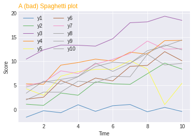

## Spaghetti plot code

```python
# libraries
import matplotlib.pyplot as plt
import numpy as np
import pandas as pd
 
# Make a data frame
df=pd.DataFrame({'x': range(1,11), 'y1': np.random.randn(10), 'y2': np.random.randn(10)+range(1,11), 'y3': np.random.randn(10)+range(11,21), 'y4': np.random.randn(10)+range(6,16), 'y5': np.random.randn(10)+range(4,14)+(0,0,0,0,0,0,0,-3,-8,-6), 'y6': np.random.randn(10)+range(2,12), 'y7': np.random.randn(10)+range(5,15), 'y8': np.random.randn(10)+range(4,14), 'y9': np.random.randn(10)+range(4,14), 'y10': np.random.randn(10)+range(2,12) })
 
# Change the style of plot
plt.style.use('seaborn-darkgrid')
 
# Create a color palette
palette = plt.get_cmap('Set1')
 
# Plot multiple lines
num=0
for column in df.drop('x', axis=1):
    num+=1
    plt.plot(df['x'], df[column], marker='', color=palette(num), linewidth=1, alpha=0.9, label=column)

# Add legend
plt.legend(loc=2, ncol=2)
 
# Add titles
plt.title("A (bad) Spaghetti plot", loc='left', fontsize=12, fontweight=0, color='orange')
plt.xlabel("Time")
plt.ylabel("Score")

# Show the graph
plt.show()
```

:::output

:::

## Other ways to represent these data

## Highlight a group  

Let’s say you plot many groups, but the actual reason for that is to explain the feature of **one particular group** compared to the others.  

Then a good practice is to **highlight** this group: make it appear different, and give it a proper annotation. Here, the behaviour of the orange line is obvious.

See the code [here](https://python-graph-gallery.com/123-highlight-a-line-in-line-plot/).

## Use small multiples  

If all groups interest you, a good solution would be to **split** them in **separate subplots**. As you can see here, the behaviour of each group is much more readable than a spaghetti plot.  

See the code of this version [here](https://python-graph-gallery.com/125-small-multiples-for-line-chart/).

## Small multiples (variant)

Another option is to do the same but display all the groups on each subplot **discretely**. It’s up to you to choose the version you prefer. [Here](https://python-graph-gallery.com/125-small-multiples-for-line-chart/) is the code.

## Area chart 

If you decide to use small multiples, I have a personal preference for using area charts instead of line plots. I find easier to see the trends in an area chart, but it is my personal opinion.

In any case, [here](https://python-graph-gallery.com/242-area-chart-and-faceting/) is the code of this chart.
