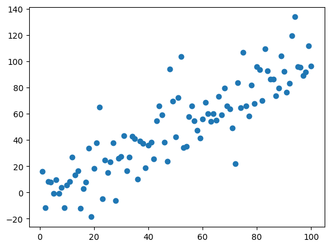

## Libraries & Dataset

Let's start by loading the necessary libraries and create a dataset

- [matplotlib](https://python-graph-gallery.com/matplotlib/): for displaying the plot
- [pandas](https://python-graph-gallery.com/pandas/): for data manipulation
- `numpy`: for data generation

```python
# libraries
import matplotlib.pyplot as plt
import numpy as np
import pandas as pd

# Create a dataset:
df = pd.DataFrame({
    'x_values': range(1, 101),
    'y_values': np.random.randn(100)*15+range(1, 101)
})
df.head()
```

:::output
::output-html{src="./output-1.html"}
:::

## Most simple scatter plot

This is a **basic scatterplot** example made with the `scatter()` function of [Matplotlib](http://python-graph-gallery.com/matplotlib/). These arguments are passed to the function:

- `x` : column name to be used for the x axis
- `y` : column name to be used for the y axis
- `data` : the dataset to be used
- `linestyle` : style of the lines between each point
- `marker` : marker style of the points

```python
fig, ax = plt.subplots()
ax.scatter(
    'x_values', 'y_values',
    data=df,
    marker='o'
)
plt.show()
```

:::output

:::

## Going further

This post explains how to create a [scatter plot](/scatter-plot/) with Matplotlib.

You might be interested in how to [custom markers in scatter plots](/131-custom-a-matplotlib-scatterplot) and how to [link title and markers in scatter plots](/how-to-custom-title-matplotlib).
