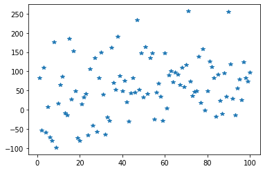
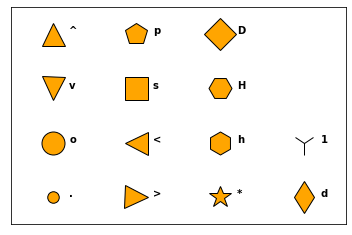
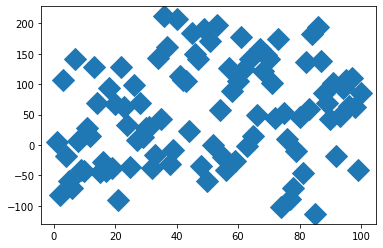
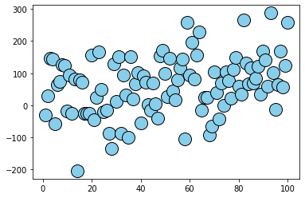
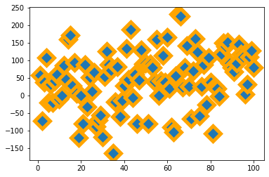

## Marker Shape

Just use the `marker` argument of the `plot()` function to custom the **shape** of the data points. The code below produces a scatter plot with star shaped markers (figure on the left).  The figure on the right shows you the possible shapes offered by python.

```python
# libraries
import matplotlib.pyplot as plt
import numpy as np
import pandas as pd
 
# dataset
df=pd.DataFrame({'x_values': range(1,101), 'y_values': np.random.randn(100)*80+range(1,101) })

# === Left figure:
plt.plot( 'x_values', 'y_values', data=df, linestyle='none', marker='*')
plt.show()
 
# === Right figure:
all_poss=['.','o','v','^','>','<','s','p','*','h','H','D','d','1','','']
 
# to see all possibilities:
# markers.MarkerStyle.markers.keys()
 
# set the limit of x and y axis:
plt.xlim(0.5,4.5)
plt.ylim(0.5,4.5)
 
# remove ticks and values of axis:
plt.xticks([])
plt.yticks([])
#plt.set_xlabel(size=0)
 
# Make a loop to add markers one by one
num=0
for x in range(1,5):
    for y in range(1,5):
        num += 1
        plt.plot(x,y,marker=all_poss[num-1], markerfacecolor='orange', markersize=23, markeredgecolor="black")
        plt.text(x+0.2, y, all_poss[num-1], horizontalalignment='left', size='medium', color='black', weight='semibold')
```

:::output



:::

## Marker Size

To change the **marker size**, just use the `markersize` argument:

```python
# libraries
import matplotlib.pyplot as plt
import numpy as np
import pandas as pd
 
# dataset
df=pd.DataFrame({'x_values': range(1,101), 'y_values': np.random.randn(100)*80+range(1,101) })

# scatter plot
plt.plot( 'x_values', 'y_values', data=df, linestyle='none', marker='D', markersize=16)
plt.show()
```

:::output

:::

## Marker Color

The color is controlled by the `markerfacecolor` and `markeredgecolor` arguments. There are several ways to call a color, see this [dedicated page](https://python-graph-gallery.com/196-select-one-color-with-matplotlib/) for more information.

```python
# libraries
import matplotlib.pyplot as plt
import numpy as np
import pandas as pd
 
# dataset
df=pd.DataFrame({'x_values': range(1,101), 'y_values': np.random.randn(100)*80+range(1,101) })

# scatter plot
plt.plot( 'x_values', 'y_values', data=df, linestyle='none', markerfacecolor='skyblue', marker="o", markeredgecolor="black", markersize=16)
plt.show()
```

:::output

:::

## Marker Edge

As you can control the marker edge color with the `markeredgecolor` argument, you can also control the marker width with the `markeredgewidth` argument.

```python
# libraries
import matplotlib.pyplot as plt
import numpy as np
import pandas as pd
 
# dataset
df=pd.DataFrame({'x_values': range(1,101), 'y_values': np.random.randn(100)*80+range(1,101) })

# scatter plot
plt.plot( 'x_values', 'y_values', data=df, linestyle='none', marker='D', markersize=16, markeredgecolor="orange", markeredgewidth=5)
plt.show()
```

:::output

:::
