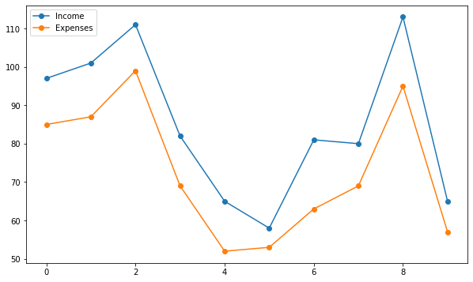
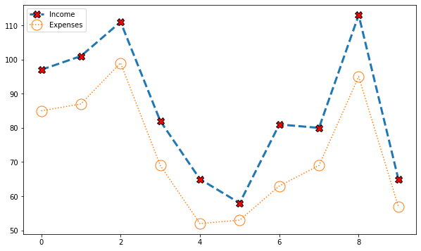
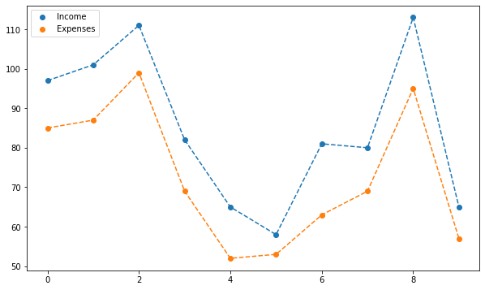
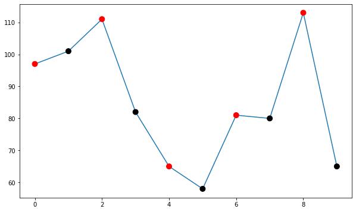

## Introduction

Connected scatterplots are just a mix between [scatterplots](http://python-graph-gallery.com/scatter-plot/) and [linecharts](http://python-graph-gallery.com/line-chart/). It can be made using the `plot()` function of [matplotlib](http://python-graph-gallery.com/matplotlib/) with the possible parameters:

* `x`: The horizontal coordinates of the data points.
* `y`: The vertical coordinates of the data points.
* `linestyle`: Line style, also abbreviated as `ls`. A list of available styles and how to customize them can be found [here](https://matplotlib.org/stable/gallery/lines_bars_and_markers/linestyles.html). Some of the most popular are `"-"` for a solid line, `"--"` for a dashed line, and `":"` for a dotted line.
* `marker`: Marker style. A complete list of available markers can be found [here](https://matplotlib.org/stable/api/markers_api.html). Some of the most popular are `"o"` for a circle, `"."` for a point, `"^"` for a triangle, etc.

If you want to customize them, just check the [scatter](http://python-graph-gallery.com/scatter-plot/) and [line](http://python-graph-gallery.com/line-chart/) sections of the website!

## Libraries & Data

```python
# Libraries
import matplotlib.pyplot as plt
import numpy as np
import pandas as pd

# Set figure default figure size
plt.rcParams["figure.figsize"] = (10, 6)
# Create a random number generator for reproducibility
rng = np.random.default_rng(1111)

# Get some random points!
x = np.array(range(10))
y = rng.integers(10, 100, 10)
z = y + rng.integers(5, 20, 10)
```

By default, `plt.plot()` generates a solid line plot. This function can also be used to obtain both a scatterplot and a lineplot at once by passing both the `linestyle` and the `marker` type.

## Default grouped connected scatterplot

```python
plt.plot(x, z, linestyle="-", marker="o", label="Income")
plt.plot(x, y, linestyle="-", marker="o", label="Expenses")
plt.legend()
plt.show()
```

:::output

:::

Notice the legend generated automatically combines both lines and markers. This legend also reflects any customization we may apply.

## Customize lines and markers

```python
plt.plot(
    x, z, ls="--", lw=3, 
    marker="X", markersize=10, markerfacecolor="red", markeredgecolor="black",
    label="Income"
)
plt.plot(
    x, y, ls=":", 
    marker="o", markersize=15, markerfacecolor="None", 
    label="Expenses"
)
plt.legend()
plt.show()
```

:::output

:::

## Legend tweaks

If you want to have only either the line or the dot in the legend you can combine `plt.scatter()` and `plt.plot()` giving the label to the one you want to include in the legend. For example:

```python
plt.scatter(x, z, label="Income")
plt.plot(x, z, ls="--")

plt.scatter(x, y, label="Expenses")
plt.plot(x, y, ls="--")

plt.legend()
plt.show()
```

:::output

:::

Constructing the connected scatterplot component by component also gives us more flexibility to customize our plot. For example, it is possible to use different colors for the markers by passing a list of colors to the `color` argument in `plt.scatter()`.

## More customization

```python
plt.plot(x, z)
plt.scatter(x, z, color=["red", "black"] * 5, s=80, zorder=10)
plt.show()
```

:::output

:::

We would have obtained an error if we had passed `color=["red", "black"] * 5` to the `plt.plot()` function.
