**Overplotting** is one of the most common problems in data visualization. When your dataset is big, points of your [scatterplot](https://python-graph-gallery.com/scatter-plot/) tend to overlap, and your graphic becomes unreadable.  

This problem is illustrated by a scatterplot, using [matplotlib](https://python-graph-gallery.com/matplotlib/) (you can see the code below). A first look might lead to the conclusion that there is **no relationship** between X and Y. We will see why it is a wrong conclusion in the sections below.

```python
# libraries
import matplotlib.pyplot as plt
import numpy as np
import seaborn as sns
import pandas as pd
 
# Dataset:
df=pd.DataFrame({'x': np.random.normal(10, 1.2, 20000), 'y': np.random.normal(10, 1.2, 20000), 'group': np.repeat('A',20000) })
tmp1=pd.DataFrame({'x': np.random.normal(14.5, 1.2, 20000), 'y': np.random.normal(14.5, 1.2, 20000), 'group': np.repeat('B',20000) })
tmp2=pd.DataFrame({'x': np.random.normal(9.5, 1.5, 20000), 'y': np.random.normal(15.5, 1.5, 20000), 'group': np.repeat('C',20000) })
df=df.append(tmp1).append(tmp2)
 
# plot
plt.plot( 'x', 'y', "", data=df, linestyle='', marker='o')
plt.xlabel('Value of X')
plt.ylabel('Value of Y')
plt.title('Overplotting looks like that:', loc='left')
plt.show()
```

:::output
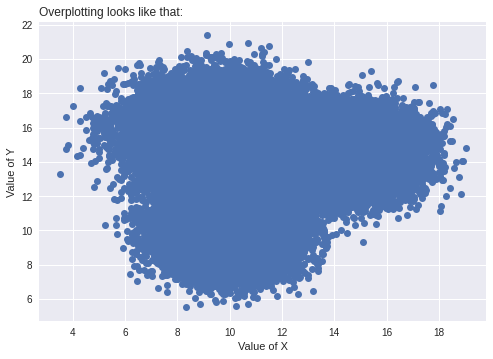
:::

## Let’s see how to avoid it:

## Dot Size

You can try to decrease marker size in your plot. This way they won't overlap and the patterns will be clearer.

```python
# libraries
import matplotlib.pyplot as plt
import numpy as np
import seaborn as sns
import pandas as pd
 
# Dataset:
df=pd.DataFrame({'x': np.random.normal(10, 1.2, 20000), 'y': np.random.normal(10, 1.2, 20000), 'group': np.repeat('A',20000) })
tmp1=pd.DataFrame({'x': np.random.normal(14.5, 1.2, 20000), 'y': np.random.normal(14.5, 1.2, 20000), 'group': np.repeat('B',20000) })
tmp2=pd.DataFrame({'x': np.random.normal(9.5, 1.5, 20000), 'y': np.random.normal(15.5, 1.5, 20000), 'group': np.repeat('C',20000) })
df=df.append(tmp1).append(tmp2)

# Plot with small marker size
plt.plot( 'x', 'y', "", data=df, linestyle='', marker='o', markersize=0.7)
plt.xlabel('Value of X')
plt.ylabel('Value of Y')
plt.title('Overplotting? Try to reduce the dot size', loc='left')
plt.show()
```

:::output
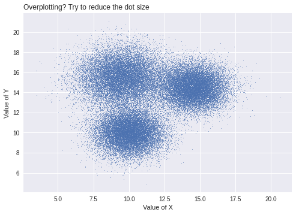
:::

## Transparency

You can change the transparency with `alpha` parameter.

```python
# libraries
import matplotlib.pyplot as plt
import numpy as np
import seaborn as sns
import pandas as pd
 
# Dataset:
df=pd.DataFrame({'x': np.random.normal(10, 1.2, 20000), 'y': np.random.normal(10, 1.2, 20000), 'group': np.repeat('A',20000) })
tmp1=pd.DataFrame({'x': np.random.normal(14.5, 1.2, 20000), 'y': np.random.normal(14.5, 1.2, 20000), 'group': np.repeat('B',20000) })
tmp2=pd.DataFrame({'x': np.random.normal(9.5, 1.5, 20000), 'y': np.random.normal(15.5, 1.5, 20000), 'group': np.repeat('C',20000) })
df=df.append(tmp1).append(tmp2)

# Plot with transparency
plt.plot( 'x', 'y', "", data=df, linestyle='', marker='o', markersize=3, alpha=0.05, color="purple")
 
# Titles
plt.xlabel('Value of X')
plt.ylabel('Value of Y')
plt.title('Overplotting? Try to use transparency', loc='left')
plt.show()
```

:::output
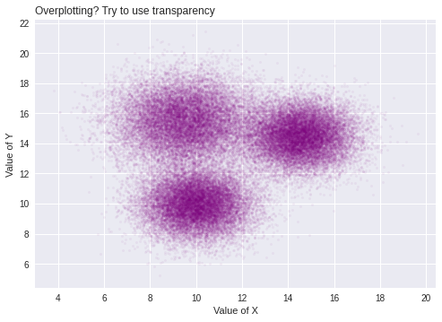
:::

## 2D Density

Density graph is a good alternative for an overplotted scatterplot. You can see the relationships between the variables better:

```python
# libraries
import matplotlib.pyplot as plt
import numpy as np
import seaborn as sns
import pandas as pd
 
# Dataset:
df=pd.DataFrame({'x': np.random.normal(10, 1.2, 20000), 'y': np.random.normal(10, 1.2, 20000), 'group': np.repeat('A',20000) })
tmp1=pd.DataFrame({'x': np.random.normal(14.5, 1.2, 20000), 'y': np.random.normal(14.5, 1.2, 20000), 'group': np.repeat('B',20000) })
tmp2=pd.DataFrame({'x': np.random.normal(9.5, 1.5, 20000), 'y': np.random.normal(15.5, 1.5, 20000), 'group': np.repeat('C',20000) })
df=df.append(tmp1).append(tmp2)

# 2D density plot:
sns.kdeplot(data = df, x="x", y="y", cmap="Reds", shade=True)
plt.title('Overplotting? Try 2D density graph', loc='left')
plt.show()
```

:::output
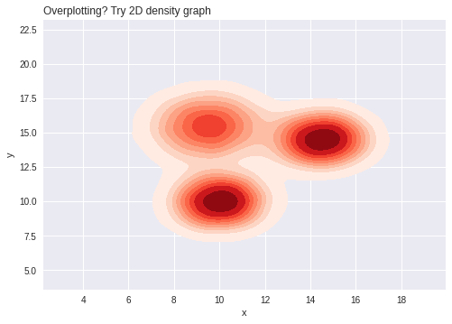
:::

## Sampling

Another alternavite solution is to decrease the number of observations. You can use the `sample()` function of pandas library to select a random sample of items:

```python
# libraries
import matplotlib.pyplot as plt
import numpy as np
import seaborn as sns
import pandas as pd
 
# Dataset:
df=pd.DataFrame({'x': np.random.normal(10, 1.2, 20000), 'y': np.random.normal(10, 1.2, 20000), 'group': np.repeat('A',20000) })
tmp1=pd.DataFrame({'x': np.random.normal(14.5, 1.2, 20000), 'y': np.random.normal(14.5, 1.2, 20000), 'group': np.repeat('B',20000) })
tmp2=pd.DataFrame({'x': np.random.normal(9.5, 1.5, 20000), 'y': np.random.normal(15.5, 1.5, 20000), 'group': np.repeat('C',20000) })
df=df.append(tmp1).append(tmp2)

# Sample 1000 random lines
df_sample=df.sample(1000)
 
# Make the plot with this subset
plt.plot( 'x', 'y', "", data=df_sample, linestyle='', marker='o')
 
# titles
plt.xlabel('Value of X')
plt.ylabel('Value of Y')
plt.title('Overplotting? Sample your data', loc='left')
plt.show()
```

:::output
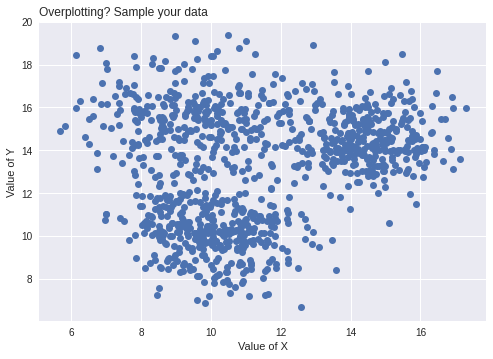
:::

## Filtering

You can filter the data by groups and label a specific group that you want to highlight with coloring it differently:

```python
# libraries
import matplotlib.pyplot as plt
import numpy as np
import seaborn as sns
import pandas as pd
 
# Dataset:
df=pd.DataFrame({'x': np.random.normal(10, 1.2, 20000), 'y': np.random.normal(10, 1.2, 20000), 'group': np.repeat('A',20000) })
tmp1=pd.DataFrame({'x': np.random.normal(14.5, 1.2, 20000), 'y': np.random.normal(14.5, 1.2, 20000), 'group': np.repeat('B',20000) })
tmp2=pd.DataFrame({'x': np.random.normal(9.5, 1.5, 20000), 'y': np.random.normal(15.5, 1.5, 20000), 'group': np.repeat('C',20000) })
df=df.append(tmp1).append(tmp2)

# Filter the data randomly
df_filtered = df[ df['group'] == 'A']
# Plot the whole dataset
plt.plot( 'x', 'y', "", data=df, linestyle='', marker='o', markersize=1.5, color="grey", alpha=0.3, label='other group')
 
# Add the group to study
plt.plot( 'x', 'y', "", data=df_filtered, linestyle='', marker='o', markersize=1.5, alpha=0.3, label='group A')
 
# Add titles and legend
plt.legend(markerscale=8)
plt.xlabel('Value of X')
plt.ylabel('Value of Y')
plt.title('Overplotting? Show a specific group', loc='left')
plt.show()
```

:::output
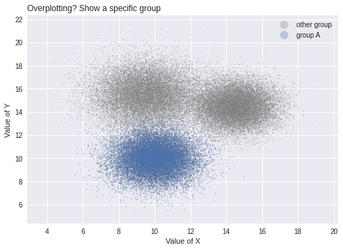
:::

## Grouping

You can easily show different groups of your data points by using the `lmplot()` function of the seaborn and passing the `hue` parameter to the function.

```python
# libraries
import matplotlib.pyplot as plt
import numpy as np
import seaborn as sns
import pandas as pd
 
# Dataset:
df=pd.DataFrame({'x': np.random.normal(10, 1.2, 20000), 'y': np.random.normal(10, 1.2, 20000), 'group': np.repeat('A',20000) })
tmp1=pd.DataFrame({'x': np.random.normal(14.5, 1.2, 20000), 'y': np.random.normal(14.5, 1.2, 20000), 'group': np.repeat('B',20000) })
tmp2=pd.DataFrame({'x': np.random.normal(9.5, 1.5, 20000), 'y': np.random.normal(15.5, 1.5, 20000), 'group': np.repeat('C',20000) })
df=df.append(tmp1).append(tmp2)

# Plot
sns.lmplot( x="x", y="y", data=df, fit_reg=False, hue='group', legend=False, palette="Accent", scatter_kws={"alpha":0.1,"s":15} )
 
# Legend
plt.legend(loc='lower right', markerscale=2)
 
# titles
plt.xlabel('Value of X')
plt.ylabel('Value of Y')
plt.title('Overplotting? Show putative structure', loc='left')
plt.show()
```

:::output
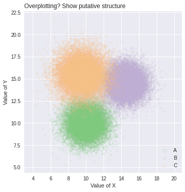
:::

## Faceting

Faceting is one of the methods you can use to avoid overlapping. Seaborn has a function `FacetGrid()` for faceting. Note that you can see [this post](https://python-graph-gallery.com/242-area-chart-and-faceting/) for more information.

```python
# libraries
import matplotlib.pyplot as plt
import numpy as np
import seaborn as sns
import pandas as pd
 
# Dataset:
df=pd.DataFrame({'x': np.random.normal(10, 1.2, 20000), 'y': np.random.normal(10, 1.2, 20000), 'group': np.repeat('A',20000) })
tmp1=pd.DataFrame({'x': np.random.normal(14.5, 1.2, 20000), 'y': np.random.normal(14.5, 1.2, 20000), 'group': np.repeat('B',20000) })
tmp2=pd.DataFrame({'x': np.random.normal(9.5, 1.5, 20000), 'y': np.random.normal(15.5, 1.5, 20000), 'group': np.repeat('C',20000) })
df=df.append(tmp1).append(tmp2)

# Use seaborn for easy faceting
g = sns.FacetGrid(df, col="group", hue="group")
g = (g.map(plt.scatter, "x", "y", edgecolor="w"))
```

:::output
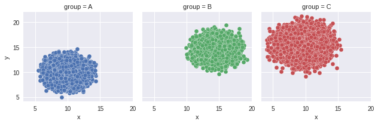
:::

## Jitter

You can use jitter when you have overlapping points, it makes easier to see the distribution. Seaborn has a function `stripplot()` you can use for this purpose:

```python
# libraries
import matplotlib.pyplot as plt
import numpy as np
import seaborn as sns
import pandas as pd

# Dataset:
a=np.concatenate([np.random.normal(2, 4, 1000), np.random.normal(4, 4, 1000), np.random.normal(1, 2, 500), np.random.normal(10, 2, 500), np.random.normal(8, 4, 1000), np.random.normal(10, 4, 1000)])
df=pd.DataFrame({'x': np.repeat( range(1,6), 1000), 'y': a })
 
# plot
plt.plot( 'x', 'y', "", data=df, linestyle='', marker='o')
plt.show()

# A scatterplot with jitter
sns.stripplot(data =df, x="x", y="y", jitter=0.2, size=2)
plt.title('Overplotting? Use jitter when x data are not really continuous', loc='left')
plt.show()
```

:::output
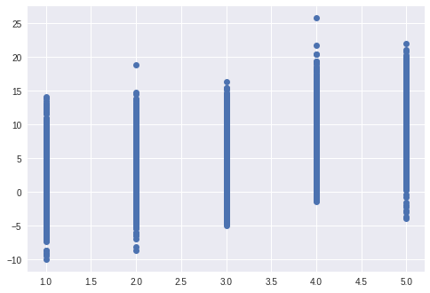

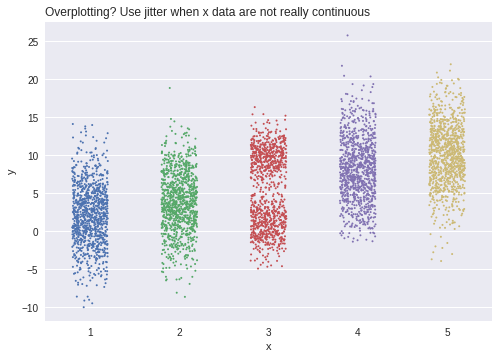
:::

## 3D

Sometimes it might be useful to use 3D graphs instead of 2D graphs in order to see distributions more clearly. The following code produces a 3D plot using the scipy library:

```python
# libraries
from scipy.stats import kde
from mpl_toolkits.mplot3d import Axes3D
import pandas as pd
import matplotlib.pyplot as plt

# Evaluate a gaussian kde on a regular grid of nbins x nbins over data extents
nbins=300
k = kde.gaussian_kde([df.x,df.y])
xi, yi = np.mgrid[ df.x.min():df.x.max():nbins*1j, df.y.min():df.y.max():nbins*1j]
zi = k(np.vstack([xi.flatten(), yi.flatten()]))

# Transform it in a dataframe
data=pd.DataFrame({'x': xi.flatten(), 'y': yi.flatten(), 'z': zi })

# Make the plot
fig = plt.figure()
ax = fig.gca(projection='3d')
ax.plot_trisurf(data.x, data.y, data.z, cmap=plt.cm.Spectral, linewidth=0.2)

# Adapt angle, first number is up/down, second number is right/left
ax.view_init(30, 80)
```

:::output
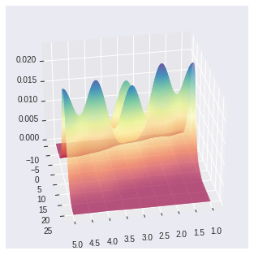
:::

## Marginal Distribution

Lastly, you can draw a marginal plot using seaborn in order to aviod overlapping in your graph. Note that you can check [this post](https://python-graph-gallery.com/82-marginal-plot-with-seaborn/) to find out details on marginal plots.

```python
# libraries
import matplotlib.pyplot as plt
import numpy as np
import seaborn as sns
import pandas as pd

# Dataset:
df=pd.DataFrame({'x': np.random.normal(10, 1.2, 20000), 'y': np.random.normal(10, 1.2, 20000), 'group': np.repeat('A',20000) })
tmp1=pd.DataFrame({'x': np.random.normal(14.5, 1.2, 20000), 'y': np.random.normal(14.5, 1.2, 20000), 'group': np.repeat('B',20000) })
tmp2=pd.DataFrame({'x': np.random.normal(9.5, 1.5, 20000), 'y': np.random.normal(15.5, 1.5, 20000), 'group': np.repeat('C',20000) })
df=df.append(tmp1).append(tmp2)

# 2D density + marginal distribution:
sns.jointplot(x=df.x, y=df.y, cmap="Blues", shade=True, kind='kde')
plt.show()
```

:::output
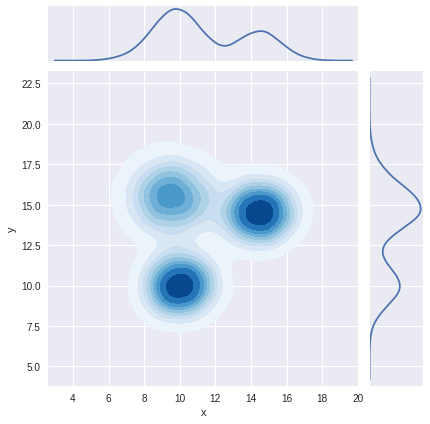
:::
