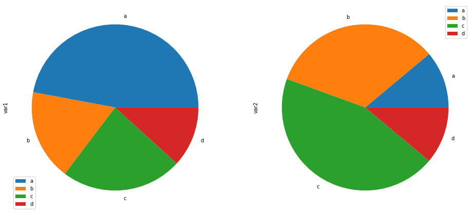

You can easily plot a pie chart using the `plot()` function of pandas library. You should pass the plot type as 'pie' in the `kind` argument.

```python
# library
import pandas as pd
import matplotlib.pyplot as plt
 
# --- dataset 1: just 4 values for 4 groups:
df = pd.DataFrame([8,8,1,2], index=['a', 'b', 'c', 'd'], columns=['x'])
 
# make the plot
df.plot(kind='pie', subplots=True, figsize=(8, 8))

# show the plot
plt.show()
```

:::output

:::

It is also possible to draw multiple plots. You can use a dataframe with multiple columns to draw multiple plots.  

Note that pie plots are a highly unadvised way to represent data. Read the intro of the [pie plot section](http://python-graph-gallery.com/pie-plot/) to learn more.

```python
# library
import pandas as pd
import matplotlib.pyplot as plt
 
# --- dataset 2: 3 columns and rownames
df = pd.DataFrame({'var1':[8,3,4,2], 'var2':[1,3,4,1]}, index=['a', 'b', 'c', 'd'] )
 
# make the multiple plot
df.plot(kind='pie', subplots=True, figsize=(16,8))

# show the plot
plt.show()
```

:::output

:::
