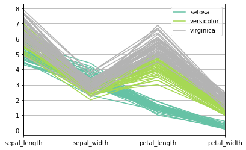

You can draw a parallel plot using **pandas** library of the python with the `parallel_coordinates()` function. In the example below, the following arguments are passed to the function:
* `data` : data frame
* `class_column` : column name containing class names
* `colormap` : colormap to use for line colors

```python
# libraries
import pandas
import matplotlib.pyplot as plt
import seaborn as sns
from pandas.plotting import parallel_coordinates
 
# Take the iris dataset
data = sns.load_dataset('iris')
 
# Make the plot
parallel_coordinates(data, 'species', colormap=plt.get_cmap("Set2"))
plt.show()
```

:::output

:::
