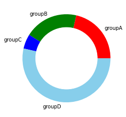
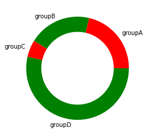
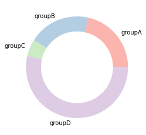
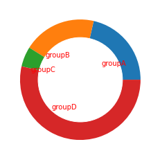
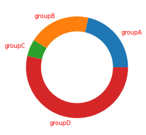
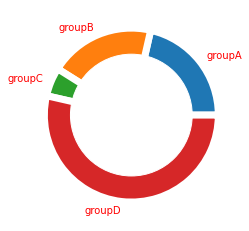

## Color

You can change the colors in your donut plot using the `colors` parameter of the `pie()` function. On the example, colors are provided one by one to the function.

```python
# library
import matplotlib.pyplot as plt
 
# create data
names = ['groupA', 'groupB', 'groupC', 'groupD']
size = [12,11,3,30]
 
# Create a circle at the center of the plot
my_circle = plt.Circle( (0,0), 0.7, color='white')

# Give color names
plt.pie(size, labels=names, colors=['red','green','blue','skyblue'])
p = plt.gcf()
p.gca().add_artist(my_circle)

# Show the graph
plt.show()
```

:::output

:::

If you do not provide enough color to the function, they will be cycled.

```python
# library
import matplotlib.pyplot as plt
 
# create data
names = ['groupA', 'groupB', 'groupC', 'groupD']
size = [12,11,3,30]
 
# Create a circle at the center of the plot
my_circle = plt.Circle( (0,0), 0.7, color='white')

# Not enough colors --> colors will cycle
plt.pie(size, labels=names, colors=['red','green'])
p = plt.gcf()
p.gca().add_artist(my_circle)

# Show the graph
plt.show()
```

:::output

:::

You can also import a [palette](https://r-graph-gallery.com/38-rcolorbrewers-palettes.html) using the [Palettable utility](https://jiffyclub.github.io/palettable/). See the [matplotlib](http://python-graph-gallery.com/matplotlib/) color page for more info!

```python
# library
import matplotlib.pyplot as plt
from palettable.colorbrewer.qualitative import Pastel1_7
 
# create data
names = ['groupA', 'groupB', 'groupC', 'groupD']
size = [12,11,3,30]
 
# Create a circle at the center of the plot
my_circle = plt.Circle( (0,0), 0.7, color='white')

from palettable.colorbrewer.qualitative import Pastel1_7
plt.pie(size, labels=names, colors=Pastel1_7.hex_colors)
p = plt.gcf()
p.gca().add_artist(my_circle)

# Show the graph
plt.show()
```

:::output

:::

## Labels

You can customize the distances of labels from the chart by using `labeldistance` parameter in the `pie()` function.

```python
# library
import matplotlib.pyplot as plt

# create data
names = ['groupA', 'groupB', 'groupC', 'groupD']
size = [12,11,3,30]
 
# Create a circle at the center of the plot
my_circle = plt.Circle( (0,0), 0.7, color='white')

# Label distance: gives the space between labels and the center of the pie
plt.pie(size, labels=names, labeldistance=0.45)
p = plt.gcf()
p.gca().add_artist(my_circle)
plt.show()
```

:::output

:::

It is possible to change the colors of labels with `rcParams`:

```python
# library
import matplotlib.pyplot as plt

# create data
names = ['groupA', 'groupB', 'groupC', 'groupD']
size = [12,11,3,30]
 
# Create a circle at the center of the plot
my_circle = plt.Circle( (0,0), 0.7, color='white')
 
# Label color
plt.rcParams['text.color'] = 'red'
plt.pie(size, labels=names)
p = plt.gcf()
p.gca().add_artist(my_circle)
plt.show()
```

:::output

:::

## Wedges

`wedgeprops` parameter can be passed to the `pie()` function in order to set width of the wedge border lines and color:

```python
# library
import matplotlib.pyplot as plt

# create data
names = ['groupA', 'groupB', 'groupC', 'groupD']
size = [12,11,3,30]
 
# Create a circle at the center of the plot
my_circle = plt.Circle( (0,0), 0.7, color='white')

# Custom wedges
plt.pie(size, labels=names, wedgeprops = { 'linewidth' : 7, 'edgecolor' : 'white' })
p = plt.gcf()
p.gca().add_artist(my_circle)
plt.show()
```

:::output

:::
