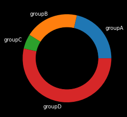

In order to change the background color, you should create a figure with `figure()` function and set the color with `patch.set_facecolor()` before creating your pie plot.

```python
# library
import matplotlib.pyplot as plt
 
# Data
names = 'groupA', 'groupB', 'groupC', 'groupD',
size = [12,11,3,30]
 
# create a figure and set different background
fig = plt.figure()
fig.patch.set_facecolor('black')
 
# Change color of text
plt.rcParams['text.color'] = 'white'
 
# Create a circle at the center of the plot
my_circle=plt.Circle( (0,0), 0.7, color='black')
 
# Pieplot + circle on it
plt.pie(size, labels=names)
p=plt.gcf()
p.gca().add_artist(my_circle)
plt.show()
```

:::output

:::
