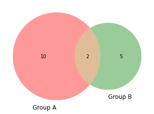
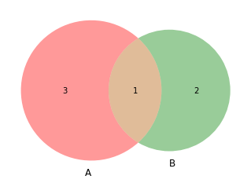

There are 2 main methods to make a [Venn diagram](http://python-graph-gallery.com/venn-diagram/) with the [matplotlib library](http://python-graph-gallery.com/matplotlib/), leading to the same result.  

The **first** way is to pass directly the sizes of your groups and their intersection to the `venn2()` function. The **second** way is to pass 2 set of values to the function, and python will calculate itself the length of each set (=each group) and the number of common values (their intersection).

```python
# library
import matplotlib.pyplot as plt
from matplotlib_venn import venn2
 
# First way to call the 2 group Venn diagram:
venn2(subsets = (10, 5, 2), set_labels = ('Group A', 'Group B'))
plt.show()
 
# Second way
venn2([set(['A', 'B', 'C', 'D']), set(['D', 'E', 'F'])])
plt.show()
```

:::output



:::
