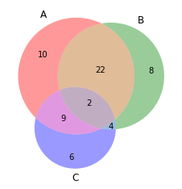

You can draw a **basic venn diagram of 3 groups** using the `venn3()` function of matplotlib. `subsets` parameter takes the values of each groups and their intersections.

```python
# Import the library
import matplotlib.pyplot as plt
from matplotlib_venn import venn3
 
# Make the diagram
venn3(subsets = (10, 8, 22, 6,9,4,2))
plt.show()
```

:::output

:::
