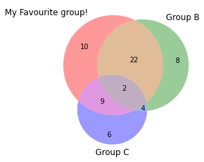
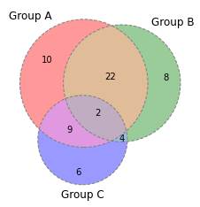
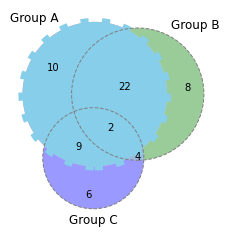

## Custom Label

You can custom the **label** of a specific group. In the example below, the label is selected by id using the `get_label_by_id()` function and then customized by the function `set_text()`.

```python
# Import the library
import matplotlib.pyplot as plt
from matplotlib_venn import venn3
 
# Custom text labels: change the label of group A
v=venn3(subsets = (10, 8, 22, 6,9,4,2), set_labels = ('Group A', 'Group B', 'Group C'))
v.get_label_by_id('A').set_text('My Favourite group!')
plt.show()
```

:::output

:::

## Line Style of Circles

It is possible to change the line style of circles using the `venn3_circles()` function.

```python
# Import the library
import matplotlib.pyplot as plt
from matplotlib_venn import venn3, venn3_circles

# Line style: can be 'dashed' or 'dotted' for example
v=venn3(subsets = (10, 8, 22, 6,9,4,2), set_labels = ('Group A', 'Group B', 'Group C'))
c=venn3_circles(subsets = (10, 8, 22, 6,9,4,2), linestyle='dashed', linewidth=1, color="grey")
plt.show()
```

:::output

:::

## Custom One Group Only

After creating the circles by `venn3_circles()`, you can select the group you want to customize by its id and use `set_lw()`, `set_ls()`, and `set_color()` functions to make customizations.

```python
# Import the library
import matplotlib.pyplot as plt
from matplotlib_venn import venn3, venn3_circles

# Change one group only
v=venn3(subsets = (10, 8, 22, 6,9,4,2), set_labels = ('Group A', 'Group B', 'Group C'))
c=venn3_circles(subsets = (10, 8, 22, 6,9,4,2), linestyle='dashed', linewidth=1, color="grey")
c[0].set_lw(8.0)
c[0].set_ls('dotted')
c[0].set_color('skyblue')
plt.show()
```

:::output

:::
