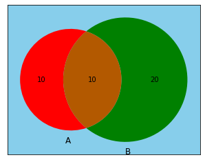

You can change the background color of a basic venn diagram using the `set_facecolor()` function of matplotlib.

```python
# Library
from matplotlib import pyplot as plt
from matplotlib_venn import venn2
 
# Basic Venn
v = venn2( (10, 20, 10), alpha = 1 )
 
# Change Backgroud
plt.gca().set_facecolor('skyblue')
plt.gca().set_axis_on()
 
# Show it
plt.show()
```

:::output

:::
