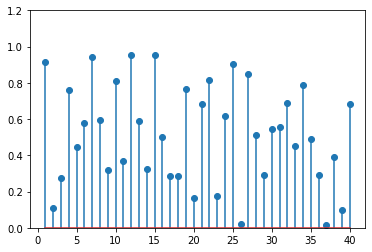
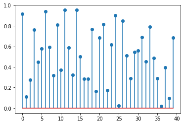
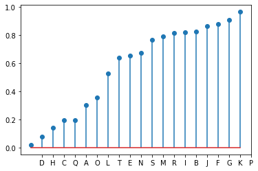
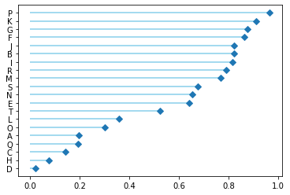

A basic **lollipop plot** can be created using the `stem()` function of [matplotlib](https://python-graph-gallery.com/matplotlib/). This function takes x axis and y axis values as an argument. x values are optional; if you do not provide x values, it will automatically assign x positions.

```python
# libraries
import matplotlib.pyplot as plt
import numpy as np
 
# create data
x=range(1,41)
values=np.random.uniform(size=40)
 
# stem function
plt.stem(x, values)
plt.ylim(0, 1.2)
plt.show()
 
# stem function: If x is not provided, a sequence of numbers is created by python:
plt.stem(values)
plt.show()
```

:::output



:::

If you have one numerical and one categorical variable, you can still draw a lollipop plot. In this case, it will be similar to a [barplot](http://python-graph-gallery.com/barplot/). **Ordering your groups** and displaying the plot **horizontally** will give you a better looking chart. The `stem()` function does not allow to make it horizontal, so you can use the `hline()` and the `plot()` functions for this purpose as follow.

```python
# libraries
import pandas as pd
import matplotlib.pyplot as plt
import numpy as np

# Create a dataframe
df = pd.DataFrame({'group':list(map(chr, range(65, 85))), 'values':np.random.uniform(size=20) })
 
# Reorder it based on the values:
ordered_df = df.sort_values(by='values')
my_range=range(1,len(df.index)+1)
 
# Make the plot
plt.stem(ordered_df['values'])
plt.xticks( my_range, ordered_df['group'])
plt.show()
 
# Horizontal version
plt.hlines(y=my_range, xmin=0, xmax=ordered_df['values'], color='skyblue')
plt.plot(ordered_df['values'], my_range, "D")
plt.yticks(my_range, ordered_df['group'])
plt.show()
```

:::output



:::
