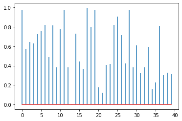
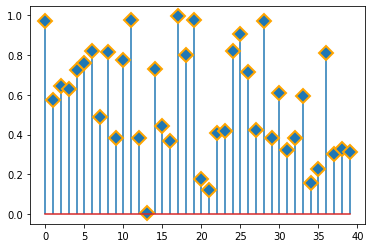
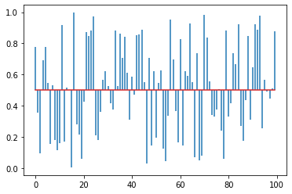
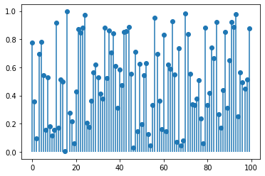
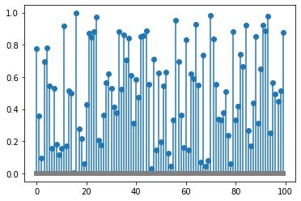
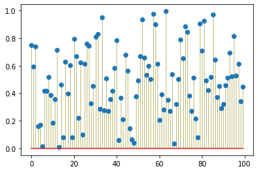

## Markers

You can easily remove the dots of the stem plot with the parameter `markerfmt`. It is also possible to change color, shape and size of the markers using `setp()` function.

```python
# libraries
import matplotlib.pyplot as plt
import numpy as np
 
# create data
values=np.random.uniform(size=40)
 
# plot without markers
plt.stem(values, markerfmt=' ')
plt.show()
 
# change color and shape and size and edges
(markers, stemlines, baseline) = plt.stem(values)
plt.setp(markers, marker='D', markersize=10, markeredgecolor="orange", markeredgewidth=2)
plt.show()
```

:::output



:::

## Baseline

The position of the baseline can be changed using `bottom` argument in the `stem()` functon. You can also customize the baseline: remove it, change its size, color, and so on using the `setp()` function.

```python
# libraries
import matplotlib.pyplot as plt
import numpy as np

# create data
values=np.random.uniform(size=100)
 
# position is customized with the `bottom` argument
plt.stem(values, markerfmt=' ', bottom=0.5)
plt.show()
 
# hide the baseline
(markers, stemlines, baseline) = plt.stem(values)
plt.setp(baseline, visible=False)
plt.show()
 
# hide the baseline - second way
plt.stem(values, basefmt=" ")
plt.show()
 
# custom the color and line style of the baseline 
(markers, stemlines, baseline) = plt.stem(values)
plt.setp(baseline, linestyle="-", color="grey", linewidth=6)
plt.show()
```

:::output






:::

## Stem

The stems can be customized as well. All the feature that you can apply to a [line plot](http://python-graph-gallery.com/line-chart/) can be applied to the stem: **color, width, type, transparency** etc.

```python
# libraries
import matplotlib.pyplot as plt
import numpy as np

# create data
values=np.random.uniform(size=100)

# custom the stem lines
(markers, stemlines, baseline) = plt.stem(values)
plt.setp(stemlines, linestyle="-", color="olive", linewidth=0.5 )
plt.show()
```

:::output

:::
