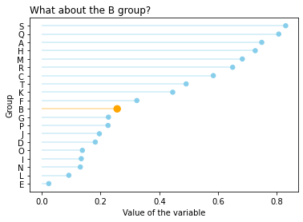

The [previous post](http://python-graph-gallery.com/182-vertical-lollipop-plot/) explains how to create a horizontal lollipop plot using the `hlines()` function of [matplotlib](https://python-graph-gallery.com/matplotlib/). In the example below, "group B" is shown with different **color** and **marker size**. In order to do it, `my_color` variable is defined; 'orange' for group B and 'skyblue' for the remaining groups. This color variable is passed to the `hlines()` function as an argument. For changing the marker sizes, the `scatter()` function of matplotlib is used.

```python
# libraries
import numpy as np
import pandas as pd
import matplotlib.pyplot as plt
 
# Create a dataframe
df = pd.DataFrame({'group':list(map(chr, range(65, 85))), 'values':np.random.uniform(size=20) })
 
# Reorder it based on values:
ordered_df = df.sort_values(by='values')
my_range=range(1,len(df.index)+1)
 
# Create a color if the group is "B"
my_color=np.where(ordered_df ['group']=='B', 'orange', 'skyblue')
my_size=np.where(ordered_df ['group']=='B', 70, 30)
 
# The horizontal plot is made using the hline() function
plt.hlines(y=my_range, xmin=0, xmax=ordered_df['values'], color=my_color, alpha=0.4)
plt.scatter(ordered_df['values'], my_range, color=my_color, s=my_size, alpha=1)
 
# Add title and axis names
plt.yticks(my_range, ordered_df['group'])
plt.title("What about the B group?", loc='left')
plt.xlabel('Value of the variable')
plt.ylabel('Group')

# show the graph
plt.show()
```

:::output

:::
