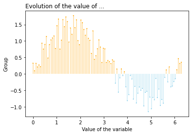

In the following example, while the lines which have negative values on the y-axis are blue, the others are orange. This **conditional color feature** makes the chart clearer for the readers. You can easily create a color variable depending on the y-axis values. Then, you just need to pass this color variable to the functions `vlines()` and `scatter()` as a `color` argument.

```python
# libraries
import matplotlib.pyplot as plt
import numpy as np
import seaborn as sns
 
# Data
x = np.linspace(0, 2*np.pi, 100)
y = np.sin(x) + np.random.uniform(size=len(x)) - 0.2
 
# Create a color if the y axis value is equal or greater than 0
my_color = np.where(y>=0, 'orange', 'skyblue')
 
# The vertical plot is made using the vline function
plt.vlines(x=x, ymin=0, ymax=y, color=my_color, alpha=0.4)
plt.scatter(x, y, color=my_color, s=1, alpha=1)
 
# Add title and axis names
plt.title("Evolution of the value of ...", loc='left')
plt.xlabel('Value of the variable')
plt.ylabel('Group')

# Show the graph
plt.show()
```

:::output

:::
