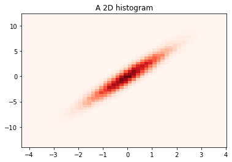
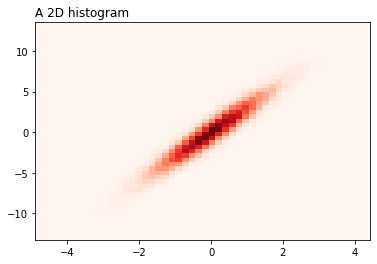
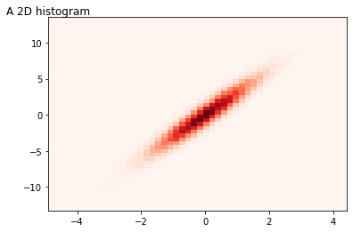
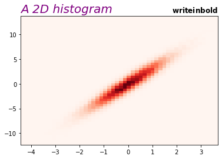
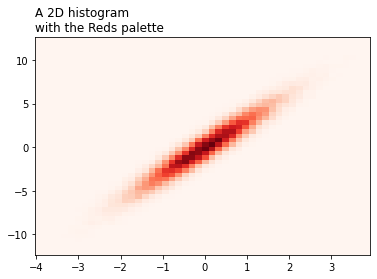
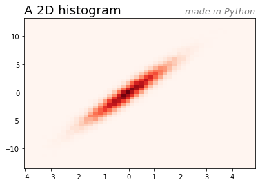
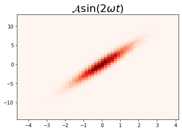
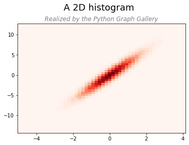
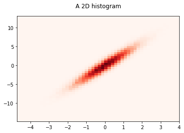

## Basic

You can add a basic title using the `title()` function of matplotlib.

```python
# libraries
import matplotlib.pyplot as plt
import numpy as np

# Data
x = np.random.normal(size=50000)
y = x * 3 + np.random.normal(size=50000)

# A histogram 2D
plt.hist2d(x, y, bins=(50, 50), cmap=plt.cm.Reds)

# Add a basic title
plt.title("A 2D histogram")

# Show the graph
plt.show()
```

:::output

:::

## Position

It is possible to control the position of title with the `loc` parameter. The available positions you can pass to the function are ‘center’, ‘left’, and ‘right’. You can also control alignment by passing the `horizontalalignment` and `verticalalignment` parameters to the function.

```python
# libraries
import matplotlib.pyplot as plt
import numpy as np

# Data
x = np.random.normal(size=50000)
y = x * 3 + np.random.normal(size=50000)

# A histogram 2D
plt.hist2d(x, y, bins=(50, 50), cmap=plt.cm.Reds)

# Control position. Available = ‘center’, ‘left’, ‘right’
plt.title("A 2D histogram", loc='left')
plt.show()
 
# Then you can adjust with horizontalalignment ('center', 'right', 'left') and
# verticalalignment ('top', 'bottom', 'center', 'baseline')
plt.hist2d(x, y, bins=(50, 50), cmap=plt.cm.Reds)
plt.title("A 2D histogram", loc='left', horizontalalignment='center', verticalalignment='center')
plt.show()
```

:::output



:::

## Font

The following parameters can be passed to the `title()` function in order to customize the font of title:
* `fontsize`
* `fontweight`
* `color`
* `style`

```python
# libraries
import matplotlib.pyplot as plt
import numpy as np

# Data
x = np.random.normal(size=50000)
y = x * 3 + np.random.normal(size=50000)

# A histogram 2D
plt.hist2d(x, y, bins=(50, 50), cmap=plt.cm.Reds)

# Italic and purple, size 20
plt.title("A 2D histogram", fontsize=20, fontweight=0, color='purple', loc='left', style='italic' )
# to write in bold
plt.title( "$\mathbf{write in bold}$" , loc="right")

# Show the graph
plt.show()
```

:::output

:::

## Multi-lines

You can easily add a new line to the title by writing **\n** where you want to add a new line in the text.

```python
# libraries
import matplotlib.pyplot as plt
import numpy as np

# Data
x = np.random.normal(size=50000)
y = x * 3 + np.random.normal(size=50000)

# A histogram 2D
plt.hist2d(x, y, bins=(50, 50), cmap=plt.cm.Reds)

plt.title('A 2D histogram\nwith the Reds palette', loc='left')
# Use plt.subplots_adjust(top=0.7) if you need to save your image. It avoids title to be truncated.

# Show the graph
plt.show()
```

:::output

:::

## Multi-title

It is possible to add more than one title to a chart:

```python
# libraries
import matplotlib.pyplot as plt
import numpy as np

# Data
x = np.random.normal(size=50000)
y = x * 3 + np.random.normal(size=50000)

# A histogram 2D
plt.hist2d(x, y, bins=(50, 50), cmap=plt.cm.Reds)

# Fist title
plt.title("A 2D histogram", loc='left', fontsize=18)

# Second title
plt.title("made in Python", loc='right', fontsize=13, color='grey', style='italic')

# Show the graph
plt.show()
```

:::output

:::

## Math

You can write mathematical expressions into your title as in this example:

```python
# libraries
import matplotlib.pyplot as plt
import numpy as np

# Data
x = np.random.normal(size=50000)
y = x * 3 + np.random.normal(size=50000)

# A histogram 2D
plt.hist2d(x, y, bins=(50, 50), cmap=plt.cm.Reds)

# Add title
plt.title("$\mathcal{A}\mathrm{sin}(2 \omega t)$", fontsize=22)

# Show the graph
plt.show()
```

:::output

:::

## Suptitle

In the example below, a suptitle is added above the figure title. The position of the suptitle is pass by the `y` parameter of the `suptitle()` function.

```python
# libraries
import matplotlib.pyplot as plt
import numpy as np

# Data
x = np.random.normal(size=50000)
y = x * 3 + np.random.normal(size=50000)

# A histogram 2D
plt.hist2d(x, y, bins=(50, 50), cmap=plt.cm.Reds)

# Add suptitle above the title
plt.suptitle("A 2D histogram\n", fontsize=18, y=1.02)

# Add title
plt.title("Realized by the Python Graph Gallery", color="grey", style='italic')

# Show the graph
plt.show()
```

:::output

:::

## Margin

You can control the margin of plot title with the `y` parameter:

```python
# libraries
import matplotlib.pyplot as plt
import numpy as np

# Data
x = np.random.normal(size=50000)
y = x * 3 + np.random.normal(size=50000)

# A histogram 2D
plt.hist2d(x, y, bins=(50, 50), cmap=plt.cm.Reds)

# Add a title
plt.title("A 2D histogram", y=1.05)

# Show the graph
plt.show()
```

:::output

:::
