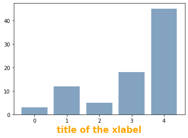
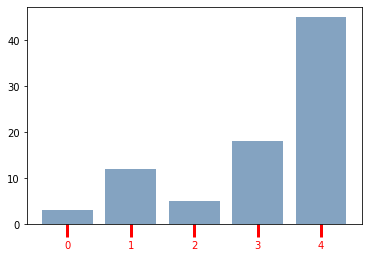
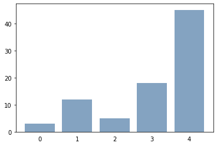
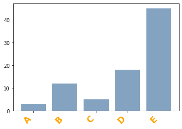
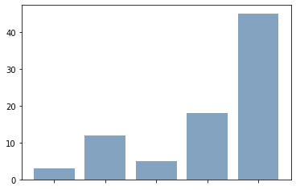
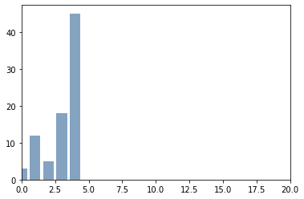

## Axis Titles

You can customize the title of your matplotlib chart with the `xlabel()` and `ylabel()` functions. You need to pass a string for the label text to the function. In the example below, the following text properties are provided to the function in order to customize the label text: `fontweight`, `color`, `fontsize`, and `horizontalalignment`.

```python
# Libraries
import numpy as np
import matplotlib.pyplot as plt

# Data set
height = [3, 12, 5, 18, 45]
bars = ('A', 'B', 'C', 'D', 'E')
y_pos = np.arange(len(bars))

# Basic bar plot
plt.bar(y_pos, height, color=(0.2, 0.4, 0.6, 0.6))
 
# Custom Axis title
plt.xlabel('title of the xlabel', fontweight='bold', color = 'orange', fontsize='17', horizontalalignment='center')

# Show the graph
plt.show()
```

:::output

:::

## Ticks

The `tick_params()` function of matplotlib makes it possible to customize x and y axis ticks. The parameters are:
* `axis` : axis to apply the parameters to (possible options are: 'x', 'y', 'both')
* `colors` : tick and label colors
* `direction` : puts ticks inside the axes, outside the axes, or both (possible options are: 'in', 'out', 'inout')
* `length` : tick length in points
* `width` : tick width in points
* `bottom` : whether to draw the respective ticks (True or False)

```python
# Libraries
import numpy as np
import matplotlib.pyplot as plt

# Data set
height = [3, 12, 5, 18, 45]
bars = ('A', 'B', 'C', 'D', 'E')
y_pos = np.arange(len(bars))

# Basic plot
plt.bar(y_pos, height, color=(0.2, 0.4, 0.6, 0.6))
 
# Custom ticks
plt.tick_params(axis='x', colors='red', direction='out', length=13, width=3)

#Show the graph
plt.show()

# You can remove them:
plt.bar(y_pos, height, color=(0.2, 0.4, 0.6, 0.6))
plt.tick_params(bottom=False)
plt.show()
```

:::output



:::

## Labels

You can customize axis tick labels with the `xticks()` and `yticks()` functions. You should provide the positions at which ticks should be placed and a list of labels to place.

```python
# Libraries
import numpy as np
import matplotlib.pyplot as plt

# Data set
height = [3, 12, 5, 18, 45]
bars = ('A', 'B', 'C', 'D', 'E')
y_pos = np.arange(len(bars))

# Basic plot
plt.bar(y_pos, height, color=(0.2, 0.4, 0.6, 0.6))
 
# use the plt.xticks function to custom labels
plt.xticks(y_pos, bars, color='orange', rotation=45, fontweight='bold', fontsize='17', horizontalalignment='right')
plt.show()
 
# remove labels
plt.bar(y_pos, height, color=(0.2, 0.4, 0.6, 0.6))
plt.tick_params(labelbottom=False)
plt.show()
```

:::output



:::

## Limits

It is possible to set the limits of the x axis using the `xlim()` function.

```python
# Libraries
import numpy as np
import matplotlib.pyplot as plt

# Data set
height = [3, 12, 5, 18, 45]
bars = ('A', 'B', 'C', 'D', 'E')
y_pos = np.arange(len(bars))

# Basic plot
plt.bar(y_pos, height, color=(0.2, 0.4, 0.6, 0.6))
 
# Set the limit
plt.xlim(0,20)

# Show the graph
plt.show()
```

:::output

:::
