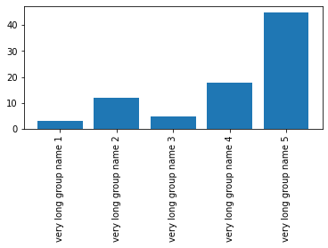
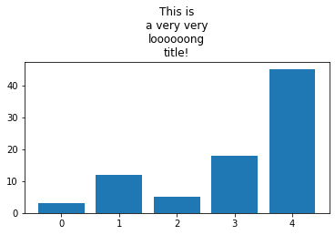

Here are a few thoughts concerning **margins** management in a [matplotlib](http://python-graph-gallery.com/matplotlib/) chart. As you can see on the left chart, expanding the margins of your plot might be necessary to make the axis labels fully readable. You can easily fix it using the `subplots_adjust()` function. Note that this function can be used to expand the **bottom margin** or the **top margin**, depending where you need more space.

```python
# Libraries
import matplotlib.pyplot as plt
import numpy as np

# Let's consider a basic barplot.
# Data
bars = ('A','B','C','D','E')
height = [3, 12, 5, 18, 45]
y_pos = np.arange(len(bars))
# Plot
plt.bar(y_pos, height)
 
# If we have long labels, we cannot see it properly
names = ("very long group name 1","very long group name 2","very long group name 3","very long group name 4","very long group name 5")
plt.xticks(y_pos, names, rotation=90)
 
# Thus we have to give more margin:
plt.subplots_adjust(bottom=0.4)

# Show the graph
plt.show()
 
# It's the same concept if you need more space for your titles

# Plot
plt.bar(y_pos, height)
# Title
plt.title("This is\na very very\nloooooong\ntitle!")
# Set margin
plt.subplots_adjust(top=0.7)
# Show the graph
plt.show()
```

:::output



:::
