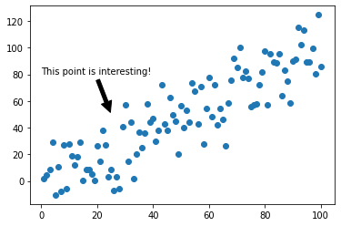
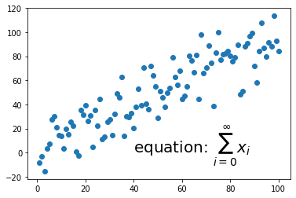
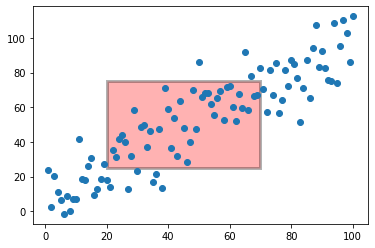
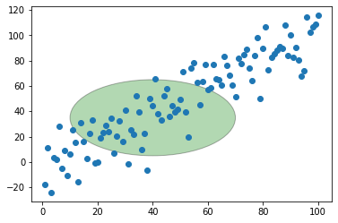
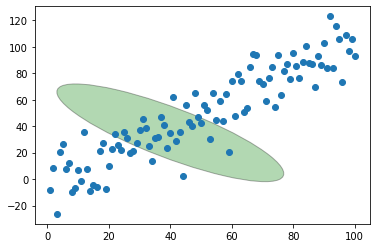
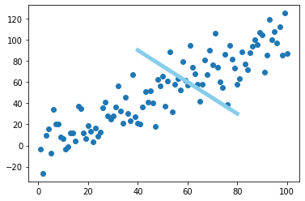
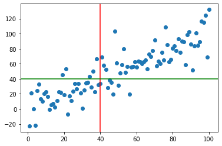

## Text

You can **annotate** any point in your chart with **text** using the `annotate()` function. The function parameters used in the example below are:
* `text` : The text of the annotation
* `xy` : The point (x,y) to annotate
* `xytext` : The position (x,y) to place the text at (If None, defaults to xy)
* `arrowprops` : The properties used to draw an arrow between the positions xy and xytext

```python
# Libraries
import matplotlib.pyplot as plt
import numpy as np
import pandas as pd
 
#Data
df=pd.DataFrame({'x_pos': range(1,101), 'y_pos': np.random.randn(100)*15+range(1,101) })

# Basic chart
plt.plot('x_pos', 'y_pos', data=df,  linestyle='none', marker='o')
 
# Annotate with text + Arrow
plt.annotate(
# Label and coordinate
'This point is interesting!', xy=(25, 50), xytext=(0, 80),
 
# Custom arrow
arrowprops=dict(facecolor='black', shrink=0.05))

# Show the graph
plt.show()
```

:::output

:::

## Math

You can add a text of mathematical expression to your plot with `text()` function:

```python
# Library
import matplotlib.pyplot as plt
import numpy as np
import pandas as pd
 
# plot
df=pd.DataFrame({'x_pos': range(1,101), 'y_pos': np.random.randn(100)*15+range(1,101) })
plt.plot( 'x_pos', 'y_pos', data=df, linestyle='none', marker='o')
 
# Annotation
plt.text(40, 0, r'equation: $\sum_{i=0}^\infty x_i$', fontsize=20)

# Show the graph
plt.show()
```

:::output

:::

## Rectangle

You can use the `add_patch()` function to add a matplotlib patch to the axes. In the example below, you will see how to add a **rectangle**. You can see the list of patches [here](https://matplotlib.org/3.3.3/api/patches_api.html).

```python
# libraries
import matplotlib.patches as patches
import matplotlib.pyplot as plt
import numpy as np
import pandas as pd
 
# Data
df=pd.DataFrame({'x_pos': range(1,101), 'y_pos': np.random.randn(100)*15+range(1,101) })
 
# Plot
fig1 = plt.figure()
ax1 = fig1.add_subplot(111)
ax1.plot( 'x_pos', 'y_pos', data=df, linestyle='none', marker='o')
 
# Add rectangle
ax1.add_patch(
patches.Rectangle(
(20, 25), # (x,y)
50, # width
50, # height
# You can add rotation as well with 'angle'
alpha=0.3, facecolor="red", edgecolor="black", linewidth=3, linestyle='solid')
)

# Show the graph
plt.show()
```

:::output

:::

## Circle

```python
# Libraries
import matplotlib.patches as patches
import matplotlib.pyplot as plt
import numpy as np
import pandas as pd
 
# Data
df=pd.DataFrame({'x_pos': range(1,101), 'y_pos': np.random.randn(100)*15+range(1,101) })
 
# Plot
fig1 = plt.figure()
ax1 = fig1.add_subplot(111)
ax1.plot( 'x_pos', 'y_pos', data=df, linestyle='none', marker='o')
 
# Annotation
ax1.add_patch(
patches.Circle(
(40, 35),           # (x,y)
30,                    # radius
alpha=0.3, facecolor="green", edgecolor="black", linewidth=1, linestyle='solid'
)
)

# Show the graph
plt.show()
```

:::output

:::

## Ellipse

```python
# libraries
import matplotlib.patches as patches
import matplotlib.pyplot as plt
import numpy as np
import pandas as pd
 
# Data
df=pd.DataFrame({'x_pos': range(1,101), 'y_pos': np.random.randn(100)*15+range(1,101) })
 
# Plot
fig1 = plt.figure()
ax1 = fig1.add_subplot(111)
ax1.plot( 'x_pos', 'y_pos', data=df, linestyle='none', marker='o')
ax1.add_patch(
patches.Ellipse(
(40, 35), # (x,y)
30, # width
100, # height
45, # radius
alpha=0.3, facecolor="green", edgecolor="black", linewidth=1, linestyle='solid'
)
)

# Show the graph
plt.show()
```

:::output

:::

## Segment

In the example below, a line segment is added to the scatterplot by using `plot()` function. The first function draws the scatterplot and the second one draws a line segment by passing 'solid' as a `linestyle` parameter.

```python
# Libraries
import matplotlib.pyplot as plt
import numpy as np
import pandas as pd
 
# Data
df=pd.DataFrame({'x_pos': range(1,101), 'y_pos': np.random.randn(100)*15+range(1,101) })
    
# Basic chart
plt.plot( 'x_pos', 'y_pos', data=df, linestyle='none', marker='o')

# Annotation
plt.plot([80, 40], [30, 90], color="skyblue", lw=5, linestyle='solid', label="_not in legend")

# Show the graph
plt.show()
```

:::output

:::

## Vertical and Horizontal Lines

It is possible to add a vertical and horizontal lines to a basic matplotlib chart using the `axvline()` and the `axhline()` functions:

```python
# Libraries
import matplotlib.pyplot as plt
import numpy as np
import pandas as pd
 
# Data   
df=pd.DataFrame({'x_pos': range(1,101), 'y_pos': np.random.randn(100)*15+range(1,101) })
    
# Plot
plt.plot( 'x_pos', 'y_pos', data=df, linestyle='none', marker='o')
 
# Annotation
plt.axvline(40, color='r')
plt.axhline(40, color='green')

# Show the graph
plt.show()
```

:::output

:::
