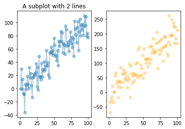
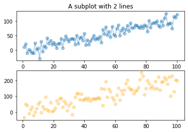
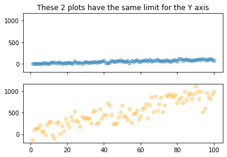
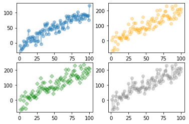
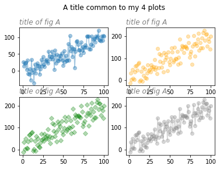
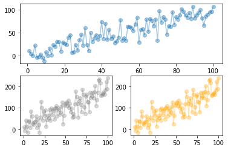
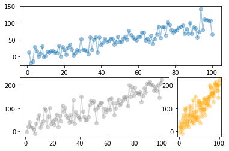
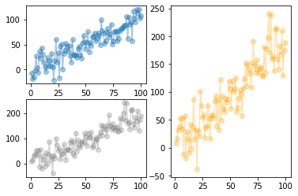

It can be really useful to **split** your graphic window into several parts in order to display **several charts** at the same time. With [matplotlib](https://python-graph-gallery.com/matplotlib/), this can be done using `subplot()` function. It is possible to display your graphics in several rows or several columns, or both. You can also control the size of each part. The examples below should allow you to understand how to use `subplot()` function:

## 2 Columns

In order to split the figure you should give 3-digit integer as a parameter to `subplot()`. The integers describe the position of subplots: first digit is the number of rows, the second is the number of columns, and the third is the index of the subplot. In the example below, `subplot(121)` indicates a figure with 1 row and 2 columns, and the following graph will be plotted at index 1. index starts at 1 in the upper left corner and increases to the right.

```python
# libraries and data
from matplotlib import pyplot as plt
import pandas as pd
import numpy as np
df=pd.DataFrame({'x_values': range(1,101), 'y_values': np.random.randn(100)*15+range(1,101), 'z_values': (np.random.randn(100)*15+range(1,101))*2 })
 
# Cut your window in 1 row and 2 columns, and start a plot in the first part
plt.subplot(121)
plt.plot( 'x_values', 'y_values', data=df, marker='o', alpha=0.4)
plt.title("A subplot with 2 lines")
 
# And now add something in the second part:
plt.subplot(122)
plt.plot( 'x_values','z_values', data=df, linestyle='none', marker='o', color="orange", alpha=0.3)
 
# Show the graph
plt.show()
```

:::output

:::

## 2 Rows

Unlike the previous example, this one shows the figure with 2 rows.

```python
# libraries and data
from matplotlib import pyplot as plt
import pandas as pd
import numpy as np
df=pd.DataFrame({'x_values': range(1,101), 'y_values': np.random.randn(100)*15+range(1,101), 'z_values': (np.random.randn(100)*15+range(1,101))*2 })
 
# fist line:
plt.subplot(211)
plt.plot( 'x_values', 'y_values', data=df, marker='o', alpha=0.4)
plt.title("A subplot with 2 lines")
 
# second line
plt.subplot(212)
plt.plot( 'x_values','z_values', data=df, linestyle='none', marker='o', color="orange", alpha=0.3)

# Show the graph
plt.show()
```

:::output

:::

## Shared Axis

You can make the plot to share the x or y axis with setting `sharex` and/or `sharey` parameters to **True**. The axis will have the same limits, ticks, and scale as the axis of the shared axes.

Notice that the index is not given to `subplot()` function in the below example. The fist graph is indicated with axes[0] and the second one with axes[1].

```python
# libraries
from matplotlib import pyplot as plt
import pandas as pd
import numpy as np
df=pd.DataFrame({'x_values': range(1,101), 'y_values': np.random.randn(100)*15+range(1,101), 'z_values': (np.random.randn(100)*15+range(1,101))*10 })
 
# initialise the figure. here we share X and Y axis
fig, axes = plt.subplots(nrows=2, ncols=1, sharex=True, sharey=True)
axes[0].plot( 'x_values', 'y_values', data=df, marker='o', alpha=0.4)
axes[1].plot( 'x_values','z_values', data=df, linestyle='none', marker='o', color="orange", alpha=0.3)
axes[0].title.set_text('These 2 plots have the same limit for the Y axis')

# Show the graph
plt.show()
```

:::output

:::

## 2 Rows and 2 Columns

This example provides a reproducible code to draw 4 graphs in the same figure: 2 rows x 2 columns.

```python
# libraries
from matplotlib import pyplot as plt
import pandas as pd
import numpy as np
df=pd.DataFrame({'x_values': range(1,101), 'y_values': np.random.randn(100)*15+range(1,101), 'z_values': (np.random.randn(100)*15+range(1,101))*2 })
 
# Cut the window with 2 rows and 2 columns:
plt.subplot(221)
plt.plot( 'x_values', 'y_values', data=df, marker='o', alpha=0.4)
plt.subplot(222)
plt.plot( 'x_values','z_values', data=df, linestyle='none', marker='o', color="orange", alpha=0.3)
plt.subplot(223)
plt.plot( 'x_values','z_values', data=df, linestyle='none', marker='D', color="green", alpha=0.3)
plt.subplot(224)
plt.plot( 'x_values','z_values', data=df, marker='o', color="grey", alpha=0.3)

# Show the graph
plt.show()
```

:::output

:::

## Title

You can give a title to the figure itself as well as the subplots in the figure. In the example below, matplotlib `title()` function is used to give title to 4 subplots separately, and `suptitle()` is used to give a superior title, figure title.

```python
# libraries and data
from matplotlib import pyplot as plt
import pandas as pd
import numpy as np
df=pd.DataFrame({'x_values': range(1,101), 'y_values': np.random.randn(100)*15+range(1,101), 'z_values': (np.random.randn(100)*15+range(1,101))*2 })
 
# initialize a figure
fig=plt.figure()
 
# Do a 2x2 chart
plt.subplot(221)
plt.plot( 'x_values', 'y_values', data=df, marker='o', alpha=0.4)
plt.title('title of fig A', fontsize=12, color='grey', loc='left', style='italic')
plt.subplot(222)
plt.plot( 'x_values','z_values', data=df, linestyle='none', marker='o', color="orange", alpha=0.3)
plt.title('title of fig A', fontsize=12, color='grey', loc='left', style='italic')
plt.subplot(223)
plt.plot( 'x_values','z_values', data=df, linestyle='none', marker='D', color="green", alpha=0.3)
plt.title('title of fig A', fontsize=12, color='grey', loc='left', style='italic')
plt.subplot(224)
plt.plot( 'x_values','z_values', data=df, marker='o', color="grey", alpha=0.3)
plt.title('title of fig A', fontsize=12, color='grey', loc='left', style='italic')
 
# Add a title:
plt.suptitle('A title common to my 4 plots', y=1.02)

# Show the graph
plt.show()
```

:::output

:::

## Custom Proportion

In order to customize the proportions of subplots on the figure, you can use `subplot2grid()` function which lets subplot to occupy multiple cells. You can see all parameters in [matplotlib documentation](https://matplotlib.org/api/_as_gen/matplotlib.pyplot.subplot2grid.html#matplotlib.pyplot.subplot2grid). These are the parameters used in our examples:
* `shape` : Number of rows and of columns of the grid in which to place axis
* `loc` : Row number and column number of the axis location within the grid
* `rowspan` : Number of rows for the axis to span to the right
* `colspan` : Number of columns for the axis to span downwards

```python
# libraries and data
from matplotlib import pyplot as plt
import pandas as pd
import numpy as np
df=pd.DataFrame({'x_values': range(1,101), 'y_values': np.random.randn(100)*15+range(1,101), 'z_values': (np.random.randn(100)*15+range(1,101))*2 })

# Plot 1
ax1 = plt.subplot2grid((2, 2), (0, 0), colspan=2)
ax1.plot( 'x_values', 'y_values', data=df, marker='o', alpha=0.4)

# Plot 2
ax2 = plt.subplot2grid((2, 2), (1, 0), colspan=1)
ax2.plot( 'x_values','z_values', data=df, marker='o', color="grey", alpha=0.3)

# Plot 3
ax3 = plt.subplot2grid((2, 2), (1, 1), colspan=1)
ax3.plot( 'x_values','z_values', data=df, marker='o', color="orange", alpha=0.3)

# Show the graph
plt.show()
```

:::output

:::

```python
# libraries and data
from matplotlib import pyplot as plt
import pandas as pd
import numpy as np
df=pd.DataFrame({'x_values': range(1,101), 'y_values': np.random.randn(100)*15+range(1,101), 'z_values': (np.random.randn(100)*15+range(1,101))*2 })
 
# 4 columns and 2 rows
# The first plot is on line 1, and is spread all along the 4 columns
ax1 = plt.subplot2grid((2, 4), (0, 0), colspan=4)
ax1.plot( 'x_values', 'y_values', data=df, marker='o', alpha=0.4)

# The second one is on column2, spread on 3 columns
ax2 = plt.subplot2grid((2, 4), (1, 0), colspan=3)
ax2.plot( 'x_values','z_values', data=df, marker='o', color="grey", alpha=0.3)

# The last one is spread on 1 column only, on the 4th column of the second line.
ax3 = plt.subplot2grid((2, 4), (1, 3), colspan=1)
ax3.plot( 'x_values','z_values', data=df, marker='o', color="orange", alpha=0.3)

# Show the graph
plt.show()
```

:::output

:::

```python
# libraries and data
from matplotlib import pyplot as plt
import pandas as pd
import numpy as np
df=pd.DataFrame({'x_values': range(1,101), 'y_values': np.random.randn(100)*15+range(1,101), 'z_values': (np.random.randn(100)*15+range(1,101))*2 })

# Plot 1
ax1 = plt.subplot2grid((2, 2), (0, 0), colspan=1)
ax1.plot( 'x_values', 'y_values', data=df, marker='o', alpha=0.4)

# Plot 2
ax2 = plt.subplot2grid((2, 2), (1, 0), colspan=1)
ax2.plot( 'x_values','z_values', data=df, marker='o', color="grey", alpha=0.3)

# Plot 3
ax3 = plt.subplot2grid((2, 2), (0, 1), rowspan=2)
ax3.plot( 'x_values','z_values', data=df, marker='o', color="orange", alpha=0.3)

# Show the graph
plt.show()
```

:::output

:::
