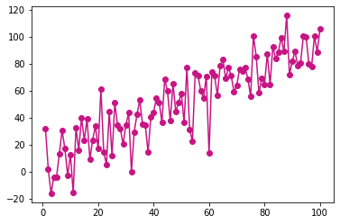
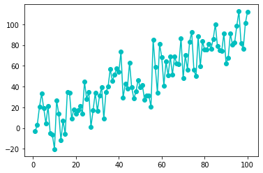
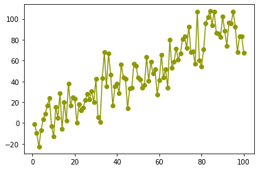
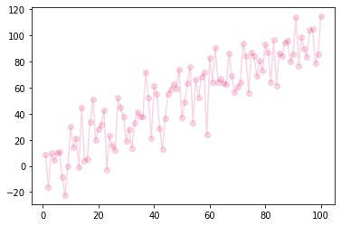
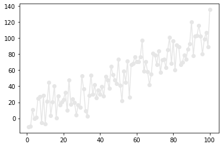
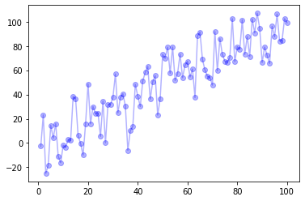

## Name

The most common way to call a color is by its **name**. It is highly advised to avoid the basic ‘blue’, ‘red’, ‘green’, etc. since they seem quite ugly in charts. There are so many other nice possibilities. See the figure which shows all the possibilities in this page.(Thanks to the Matplotlib documentation for their work).

```python
# libraries
from matplotlib import pyplot as plt
import pandas as pd
import numpy as np

# dataset
df=pd.DataFrame({'x_pos': range(1,101), 'y_pos': np.random.randn(100)*15+range(1,101)})
 
# plot
plt.plot( 'x_pos', 'y_pos', data=df, marker='o', color='mediumvioletred')

# show the graph
plt.show()
```

:::output

:::

## Abbreviation

It is also possible to call a color with the **abbreviation** of its name:

```python
# libraries
from matplotlib import pyplot as plt
import pandas as pd
import numpy as np

# dataset
df=pd.DataFrame({'x_pos': range(1,101), 'y_pos': np.random.randn(100)*15+range(1,101)})
 
# Plot
plt.plot( 'x_pos', 'y_pos', data=df, marker='o', color='c')

# Show the graph
plt.show()
```

:::output

:::

## Hex Code

This example shows how to use **hex codes** to call a name:

```python
# library
from matplotlib import pyplot as plt
import pandas as pd
import numpy as np

# dataset
df=pd.DataFrame({'x_pos': range(1,101), 'y_pos': np.random.randn(100)*15+range(1,101)})
 
# plot
plt.plot( 'x_pos', 'y_pos', data=df, marker='o', color='#8f9805')

# show the graph
plt.show()
```

:::output

:::

## RGB

Here is an example which passes an RGB colors to the plot:

```python
# libraries
from matplotlib import pyplot as plt
import pandas as pd
import numpy as np

# dataset
df=pd.DataFrame({'x_pos': range(1,101), 'y_pos': np.random.randn(100)*15+range(1,101)})
 
# plot
plt.plot( 'x_pos', 'y_pos', data=df, marker='o', color=(0.9, 0.2, 0.5, 0.2))

# show the graph
plt.show()
```

:::output

:::

## Black and White

Here is an example of black and white plot:

```python
# libraries
from matplotlib import pyplot as plt
import pandas as pd
import numpy as np

# dataset
df=pd.DataFrame({'x_pos': range(1,101), 'y_pos': np.random.randn(100)*15+range(1,101)})

# plot
plt.plot( 'x_pos', 'y_pos', data=df, marker='o', color='0.9')

# show the graph
plt.show()
```

:::output

:::

## Transparency

You can change the color transparency with the `alpha` parameter:

```python
# libraries
from matplotlib import pyplot as plt
import pandas as pd
import numpy as np

# dataset
df=pd.DataFrame({'x_pos': range(1,101), 'y_pos': np.random.randn(100)*15+range(1,101)})

# plot
plt.plot( 'x_pos', 'y_pos', data=df, marker='o', color='blue', alpha=0.3)

# show the graph
plt.show()
```

:::output

:::
