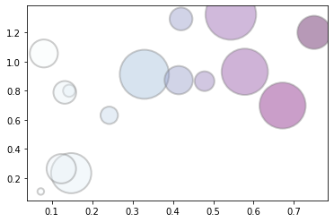
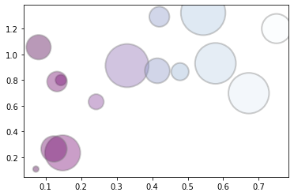
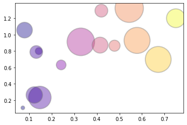
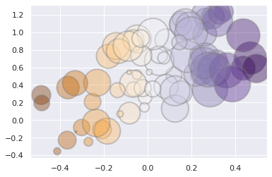
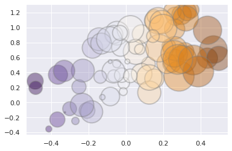
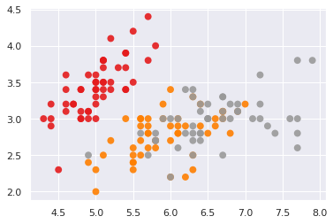

There are 3 types of color palettes: **Sequential**, **Discrete** and **Diverging**. Here are a few explanations for each:

## Sequential

```python
# libraries
from matplotlib import pyplot as plt
import numpy as np
 
# create data
x = np.random.rand(15)
y = x+np.random.rand(15)
z = x+np.random.rand(15)
z=z*z
 
# call pallette in cmap
plt.scatter(x, y, s=z*2000, c=x, cmap="BuPu", alpha=0.4, edgecolors="grey", linewidth=2)
plt.show()
 
# You can reverse it by adding "_r" to the end:
plt.scatter(x, y, s=z*2000, c=x, cmap="BuPu_r", alpha=0.4, edgecolors="grey", linewidth=2)
plt.show()

# OTHER: viridis / inferno / plasma / magma
plt.scatter(x, y, s=z*2000, c=x, cmap="plasma", alpha=0.4, edgecolors="grey", linewidth=2)
plt.show()
```

:::output





:::

## Diverging

```python
# libraries
from matplotlib import pyplot as plt
import numpy as np
import seaborn as sns

#Just use set_theme() function of seaborn library for a nice looking appearance.
sns.set_theme()

# create data
x = np.random.rand(80) - 0.5
y = x+np.random.rand(80)
z = x+np.random.rand(80)
 
# plot
plt.scatter(x, y, s=z*2000, c=x, cmap="PuOr", alpha=0.4, edgecolors="grey", linewidth=2)
plt.show()
 
# reverse
plt.scatter(x, y, s=z*2000, c=x, cmap="PuOr_r", alpha=0.4, edgecolors="grey", linewidth=2)
plt.show()
```

:::output



:::

## Discrete

```python
# libraries
from matplotlib import pyplot as plt
import numpy as np
import pandas as pd
import seaborn as sns
 
# Data
df = sns.load_dataset('iris')
 
# We use the species column to choose the color. We need to make a numerical vector from it:
df['species']=pd.Categorical(df['species'])
df['species'].cat.codes
 
# Scatter plot
plt.scatter(df['sepal_length'], df['sepal_width'], s=62, c=df['species'].cat.codes, cmap="Set1", alpha=0.9, linewidth=0)
plt.show()
```

:::output

:::
