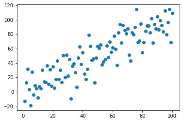
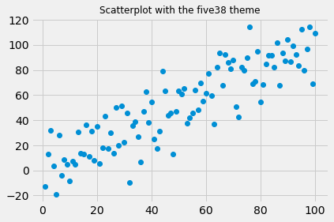
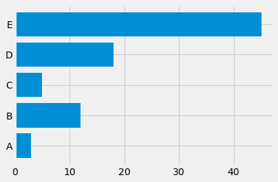

## List of themes

The list of available `matplotlib` themes is stored in a list called `plt.style.available`. There are 26 of them.

```python
import matplotlib.pyplot as plt
plt.style.available
```

:::output
```text
['Solarize_Light2',
 '_classic_test_patch',
 'bmh',
 'classic',
 'dark_background',
 'fast',
 'fivethirtyeight',
 'ggplot',
 'grayscale',
 'seaborn',
 'seaborn-bright',
 'seaborn-colorblind',
 'seaborn-dark',
 'seaborn-dark-palette',
 'seaborn-darkgrid',
 'seaborn-deep',
 'seaborn-muted',
 'seaborn-notebook',
 'seaborn-paper',
 'seaborn-pastel',
 'seaborn-poster',
 'seaborn-talk',
 'seaborn-ticks',
 'seaborn-white',
 'seaborn-whitegrid',
 'tableau-colorblind10']
```
:::

## Scatterplot

The [scatterplot section](https://python-graph-gallery.com/scatter-plot/) of the gallery explains in depth how to build a basic scatterplot with `matplotlib`. It is pretty straightforward thanks to the `plot()` function.

```python
# Create a dataset:
import numpy as np
import pandas as pd
df=pd.DataFrame({'x': range(1,101), 'y': np.random.randn(100)*15+range(1,101) })
 
# plot
plt.plot( 'x', 'y', data=df, linestyle='none', marker='o')
plt.show()
```

:::output

:::

## Apply a theme

Now, let's make this chart a bit prettier thanks to the style called `fivethirtyeight`. In case you don't know it already, [FiveThirtyeight](https://fivethirtyeight.com) is an online newspaper that often displays some very nice dataviz articles.

```python
plt.style.use('fivethirtyeight')
plt.plot( 'x', 'y', data=df, linestyle='none', marker='o')
plt.title('Scatterplot with the five38 theme', fontsize=12)
plt.show()
```

:::output

:::

## Apply the style on a barchart

You can apply the same exact tip for any kind of chart to make it look better. Here is a barchart example coming from the barchart section of the gallery. It uses the `dark_background` theme to demo another type of customization.

```python
# create dataset
height = [3, 12, 5, 18, 45]
bars = ('A', 'B', 'C', 'D', 'E')
y_pos = np.arange(len(bars))
 
# Create horizontal bars
plt.barh(y_pos, height)
 
# Create names on the x-axis
plt.yticks(y_pos, bars)
 
# Show graphic
plt.style.use('dark_background')
plt.show()
```

:::output

:::
