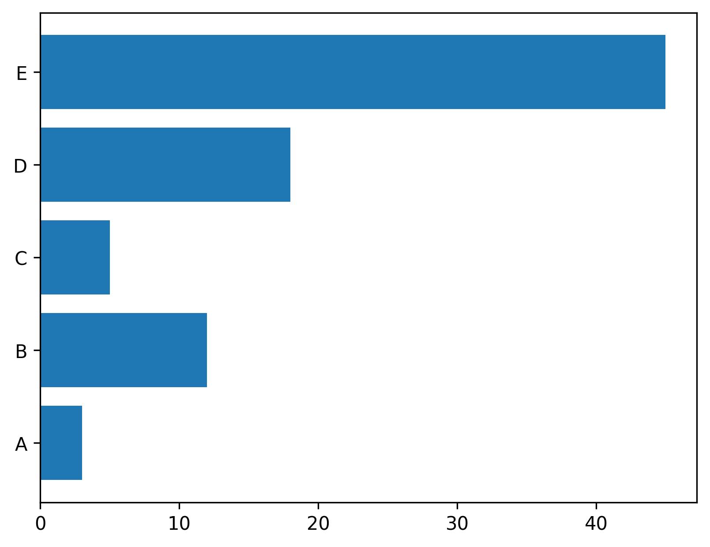
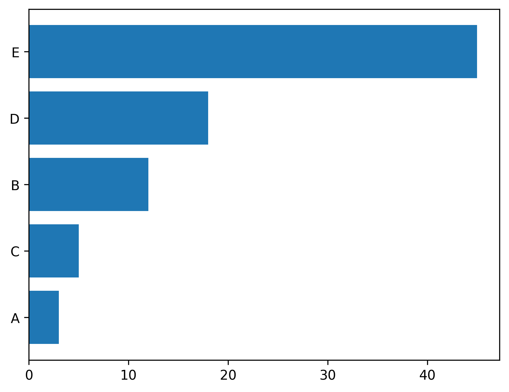

## Libraries & Dataset

First, we need to load a few libraries and a dataset:

```python
# libraries
import matplotlib.pyplot as plt
import numpy as np
import pandas as pd

# create dataset
height = [3, 12, 5, 18, 45]
bars = ('A', 'B', 'C', 'D', 'E')

df = pd.DataFrame({
    'Group': bars,
    'Value': height
})
```

## 📍 Most basic

Building a horizontal barplot with [matplotlib](http://python-graph-gallery.com/matplotlib/) follows pretty much the same process as a vertical [barplot](http://python-graph-gallery.com/barplot/). The only difference is that the `barh()` function must be used instead of the `bar()` function. Here is a basic example:

```python
# Create horizontal bars
plt.barh(y=df.Group, width=df.Value)

# Show graphic
plt.show()
```

:::output

:::

## ↕️ Control order

A [bar chart](http://python-graph-gallery.com/barplot/) is always more insightful when ordered. It allows to understand how items are ranked much quicker. Since [matplotlib](http://python-graph-gallery.com/matplotlib/) traces the values in the **order in which they are found** in the data frame, you just have to **sort the dataframe** upfront to sort the chart:

```python
# Sort the table
df = df.sort_values(by=['Value'])

# Create horizontal bars
plt.barh(y=df.Group, width=df.Value)

# Display the plot
plt.show()
```

:::output

:::

## ✨ Object-oriented API

Same graph as above using the matplotlib object `oriented API` instead of the `pyplot API`. See the [matplotlib](http://python-graph-gallery.com/matplotlib/) section for more about this.

```python
# Initialize a Figure and an Axes
fig, ax = plt.subplots()

# Create horizontal bars
ax.barh(y=df.Group, width=df.Value)

# Show the plot
plt.show()
```

:::output

:::

## Going further

This post explains how to create a horizontal [barplot](https://python-graph-gallery.com/barplot/) using [matplotlib](https://python-graph-gallery.com/matplotlib/)!

For more examples of **how to create or customize** your barplots, see the [barplot section](https://python-graph-gallery.com/barplot/). You may also be interested in how to [custom colors in a barplot](https://python-graph-gallery.com/3-control-color-of-barplots/).
