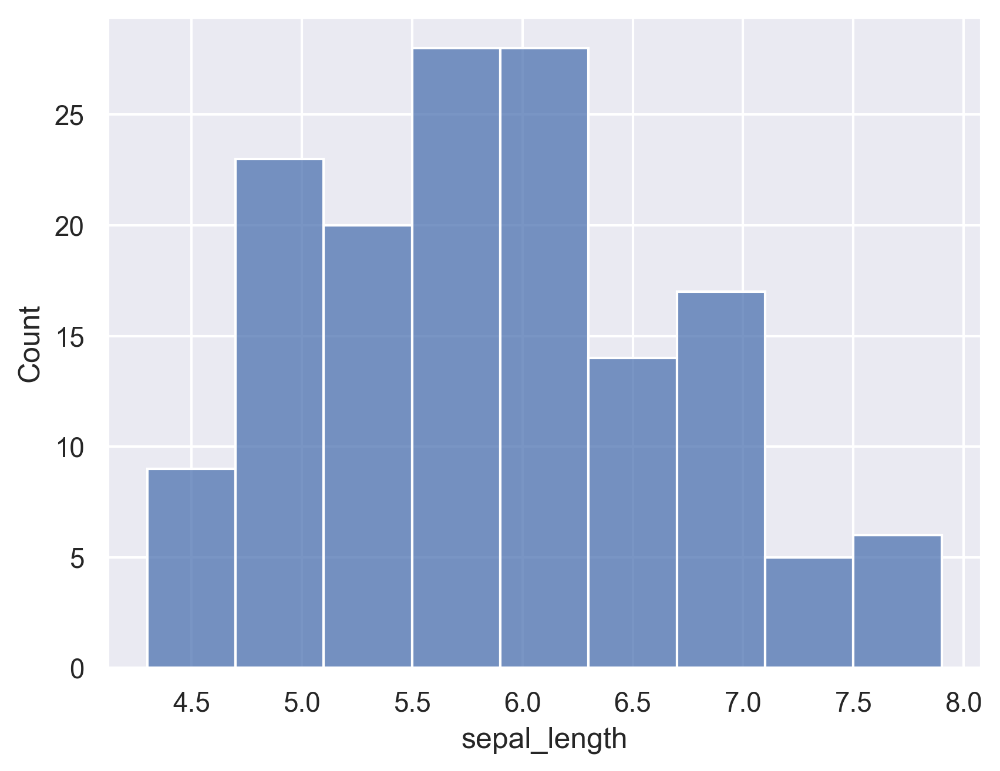
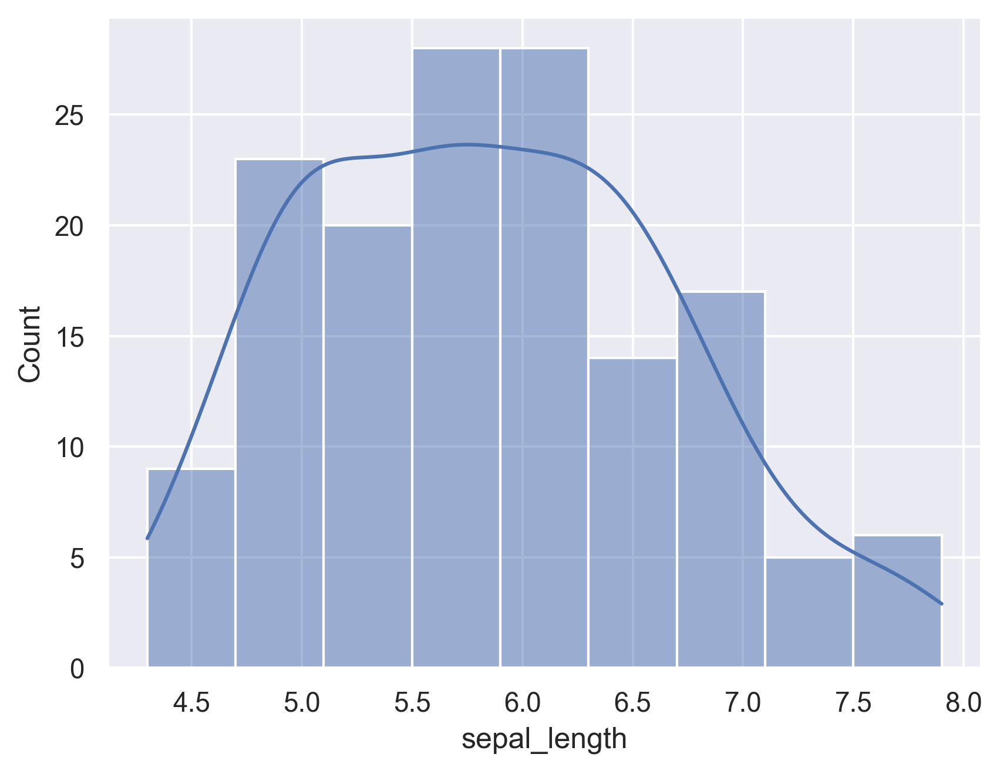
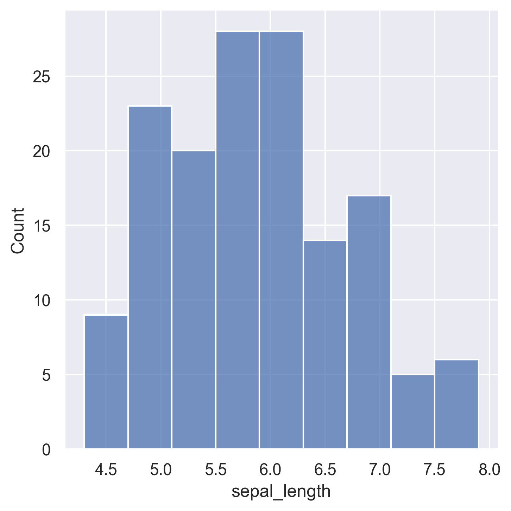
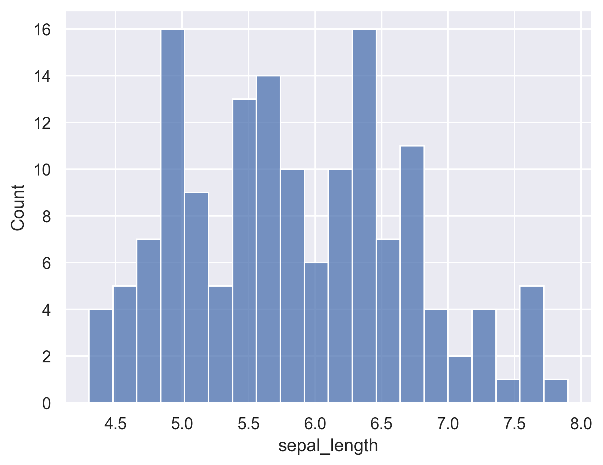

With Seaborn, histograms are made using the [histplot function](https://seaborn.pydata.org/generated/seaborn.histplot.html#seaborn.histplot). You can call the function with default values, what already gives a nice chart. Though, do not forget to play with the number of bins using the ‘bins’ argument. Indeed, a pattern can be hidden under the hood that one would not be able to detect with default bins values.

## Drawing a simple histogram with default parameters

```python
# libraries & dataset
import seaborn as sns
import matplotlib.pyplot as plt
  
sns.set_theme(style="darkgrid")
df = sns.load_dataset("iris")
sns

sns.histplot(data=df, x="sepal_length")
plt.show()
```

:::output

:::

You can add a kde curve to a histogram by setting the `kde` argument to True.

```python
# libraries & dataset
import seaborn as sns
import matplotlib.pyplot as plt
# set a grey background (use sns.set_theme() if seaborn version 0.11.0 or above, set otherwise) 
sns.set_theme(style="darkgrid")
df = sns.load_dataset("iris")

sns.histplot(data=df, x="sepal_length", kde=True)
plt.show()
```

:::output

:::

Another way of drawing a histogram with Seaborn is by using the `displot()` function. In versions before 0.11.0, it was named `distplot()` but it's now deprecated. Refer to the [new displot function documentation](https://seaborn.pydata.org/generated/seaborn.displot.html#seaborn.displot) for future use.

```python
# libraries & dataset
import seaborn as sns
import matplotlib.pyplot as plt
  
sns.set_theme(style="darkgrid")
df = sns.load_dataset("iris")

sns.displot(df["sepal_length"])
plt.show()
```

:::output

:::

## Controlling for the number of bins

```python
# libraries & dataset
import seaborn as sns
import matplotlib.pyplot as plt
  
sns.set_theme(style="darkgrid")
df = sns.load_dataset("iris")

sns.histplot(data=df, x="sepal_length", bins=20)
plt.show()
```

:::output

:::
