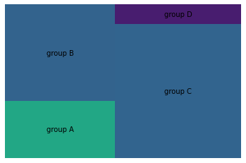
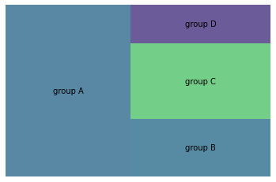

You can generate a **basic treemap** using the `plot()` function of **squarify** library in python. The function requires the following parameters:
* `sizes` : a list (or a column of data frame) of values
* `label` : a list (or a column of data frame) of label text

In a treemap, each square will be as big as its value.

```python
# libraries
import pandas as pd
import matplotlib.pyplot as plt
import squarify    # pip install squarify (algorithm for treemap)
 
# If you have 2 lists
squarify.plot(sizes=[13,22,35,5], label=["group A", "group B", "group C", "group D"], alpha=.7 )
plt.axis('off')
plt.show()
 
# If you have a data frame
df = pd.DataFrame({'nb_people':[8,3,4,2], 'group':["group A", "group B", "group C", "group D"] })
squarify.plot(sizes=df['nb_people'], label=df['group'], alpha=.8 )
plt.axis('off')
plt.show()
```

:::output



:::
