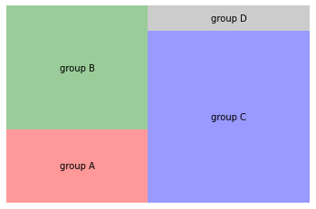

You can set the color of each group in a treemap using the `color` parameter:

```python
#libraries
import matplotlib.pyplot as plt
import squarify # pip install squarify (algorithm for treemap)
 
# Change color
squarify.plot(sizes=[13,22,35,5], label=["group A", "group B", "group C", "group D"], color=["red","green","blue", "grey"], alpha=.4 )
plt.axis('off')
plt.show()
```

:::output

:::
