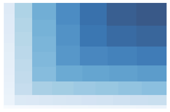

You can create a treemap with colors mapped on values by using squarify and matplotlib libraries. In the following example, in order to map colors, `matplotlib.colors.Normalize()` is used with `vmin` and `vmax`, minimum values and maximum values respectively. Each value in my_values list is normalized and then map to a color.

```python
#libraries
import matplotlib
import matplotlib.pyplot as plt
import squarify # pip install squarify (algorithm for treemap)&lt;/pre&gt;
 
# Create a dataset:
my_values=[i**3 for i in range(1,100)]
 
# create a color palette, mapped to these values
cmap = matplotlib.cm.Blues
mini=min(my_values)
maxi=max(my_values)
norm = matplotlib.colors.Normalize(vmin=mini, vmax=maxi)
colors = [cmap(norm(value)) for value in my_values]
 
# Change color
squarify.plot(sizes=my_values, alpha=.8, color=colors )
plt.axis('off')
plt.show()
```

:::output

:::
