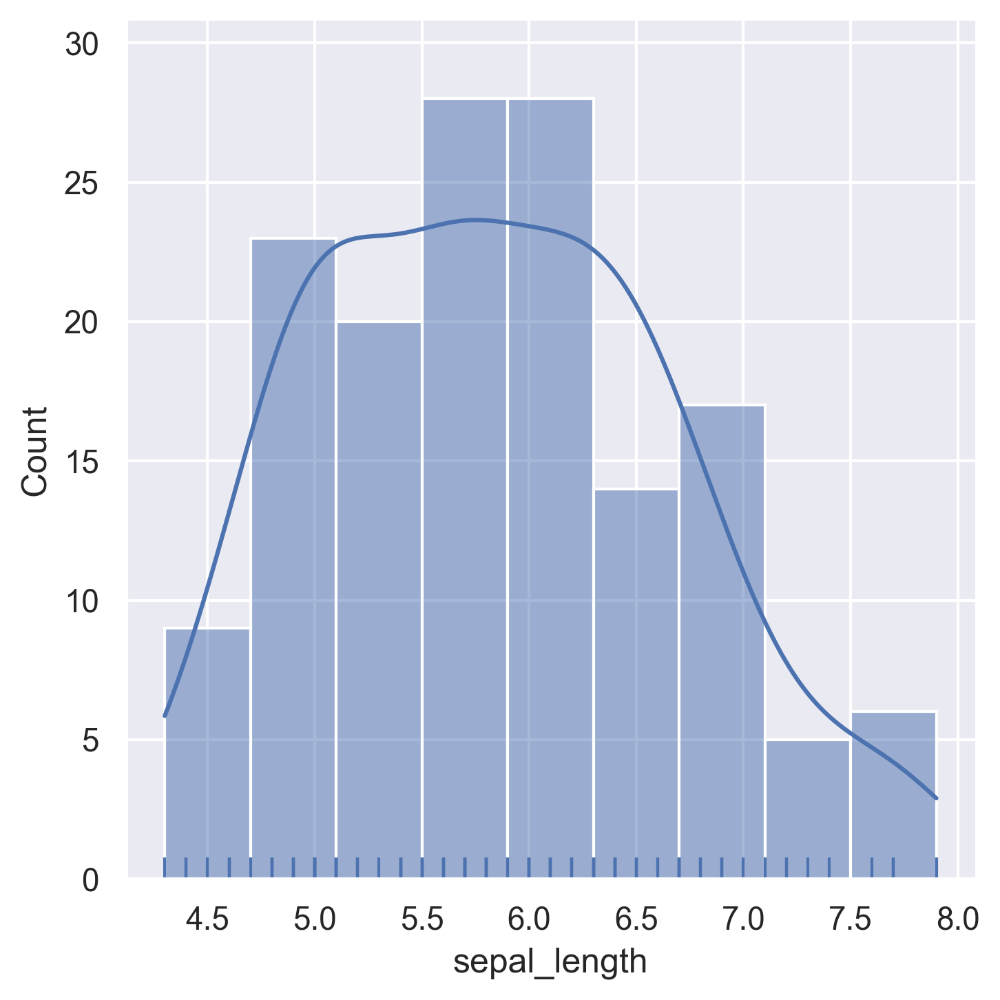
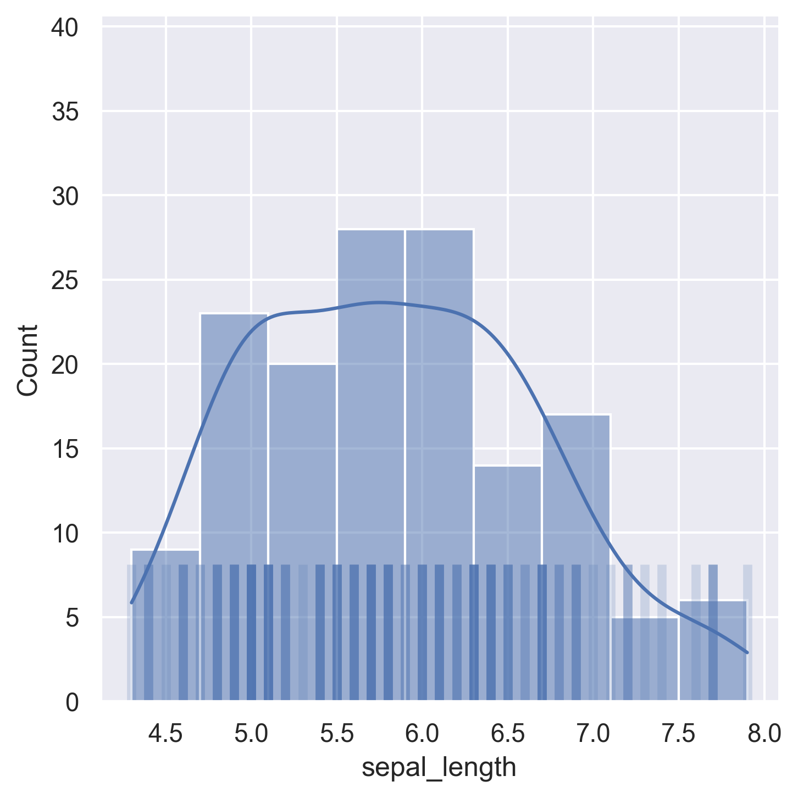
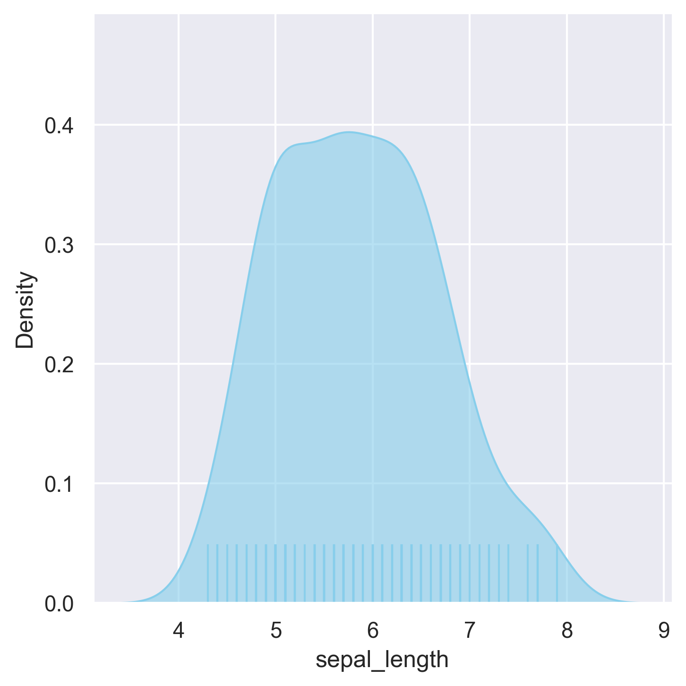

## Libraries & Dataset

First, we need to load a few libraries and the iris dataset:

```python
# libraries
import seaborn as sns
import matplotlib.pyplot as plt
sns.set_theme(style="darkgrid")

# dataset
df = sns.load_dataset("iris")
```

## Histogram + rug + kernel density curve

**Rugs** are small lines or marks at the edge of a plot that represent the **distribution of individual** data points along an axis.

```python
sns.displot(data=df["sepal_length"], kde=True, rug=True)
plt.show()
```

:::output

:::

## Customizing rugs

Thanks to the `rug_kws` argument, we can easily change how the **rugs** look like!

```python
sns.displot(df["sepal_length"],
            kde=True,
            rug=True,
            rug_kws={"alpha": 0.2, "linewidth": 4, "height": 0.2})
plt.show()
```

:::output

:::

## Customizing the density curve

It's also pretty straight forward to customize the density curve in a chart:

```python
sns.displot(df["sepal_length"],
            kind="kde",
            fill=True,
            rug=True,
            rug_kws={"alpha": 0.9, "height": 0.1},
            color="skyblue",
            alpha=0.6,)
plt.show()
```

:::output

:::

## Going further

This post explains how to customize a [distribution plot](https://python-graph-gallery.com/density-plot/) by adding rugs and density to it using [seaborn](https://python-graph-gallery.com/seaborn/)!

For more examples of **how to create or customize** your distribution plots, see the [density plot section](https://python-graph-gallery.com/density-plot/). You may also be interested in how to create a [density chart with multiple groups](https://python-graph-gallery.com/74-density-plot-of-several-variables/).
