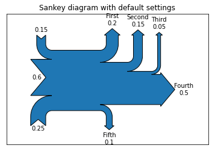

The matplotlib library has a module `Sankey` that allows to make basic Sankey Diagrams. This is an example taken from the corresponding [documentation](https://matplotlib.org/api/sankey_api.html) where you will find more examples of this type.  

These are the parameters used in the example:
* `flows` : Array of flow values. By convention, inputs are positive and outputs are negative.
* `labels` : List of labels for the flows (or a single label to be used for all flows).
* `orientations` : List of orientations of the flows (or a single orientation to be used for all flows). Valid values are 0 (inputs from the left, outputs to the right), 1 (from and to the top) or -1 (from and to the bottom).

```python
# Libraries
import numpy as np
import matplotlib.pyplot as plt
from matplotlib.sankey import Sankey
 
# basic sankey chart
Sankey(flows=[0.25, 0.15, 0.60, -0.20, -0.15, -0.05, -0.50, -0.10], labels=['', '', '', 'First', 'Second', 'Third', 'Fourth', 'Fifth'], orientations=[-1, 1, 0, 1, 1, 1, 0,-1]).finish()
plt.title("Sankey diagram with default settings")
plt.show()
```

:::output

:::
