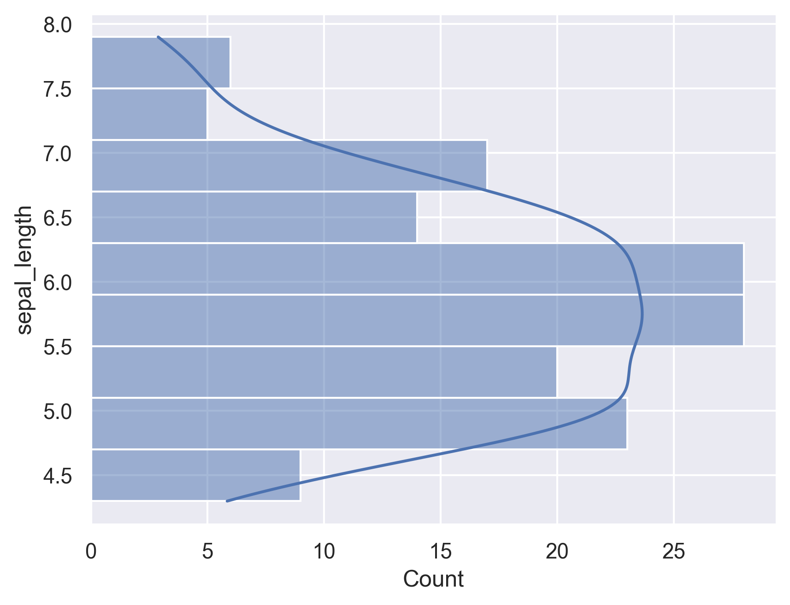

## Libraries

First, we need to import the following libraries:

- [matplotlib](https://python-graph-gallery.com/matplotlib/) for customizing the chart
- [seaborn](https://python-graph-gallery.com/seaborn/) for creating the chart

```python
import seaborn as sns
import matplotlib.pyplot as plt
```

## Dataset

We'll use the iris dataset that is available using the `load_dataset()` function from **seaborn**

```python
df = sns.load_dataset("iris")
```

## Flipped histogram

Flipping a histogram with seaborn is **easy**: you just have to specify that you want to display it on the `y axis`.

```python
  
sns.set_theme(style="darkgrid")

# Create the plot
sns.histplot(data=df, y="sepal_length")
plt.show()
```

:::output

:::

## Flipped histogram with density estimation

If you want to add the **density estimation**, you have to add `kde=True` in the `histplot` function

```python
  
sns.set_theme(style="darkgrid")

# Create the plot
sns.histplot(data=df, y="sepal_length", kde=True)
plt.show()
```

:::output

:::

## Going further

This post explains how to create a flipped histogram with [seaborn](https://python-graph-gallery.com/seaborn/).

You might be interested in creating [histogram with multiple groups](https://python-graph-gallery.com/25-histogram-with-several-variables-seaborn/) or [controlling the bins](https://python-graph-gallery.com/20-basic-histogram-seaborn/).
