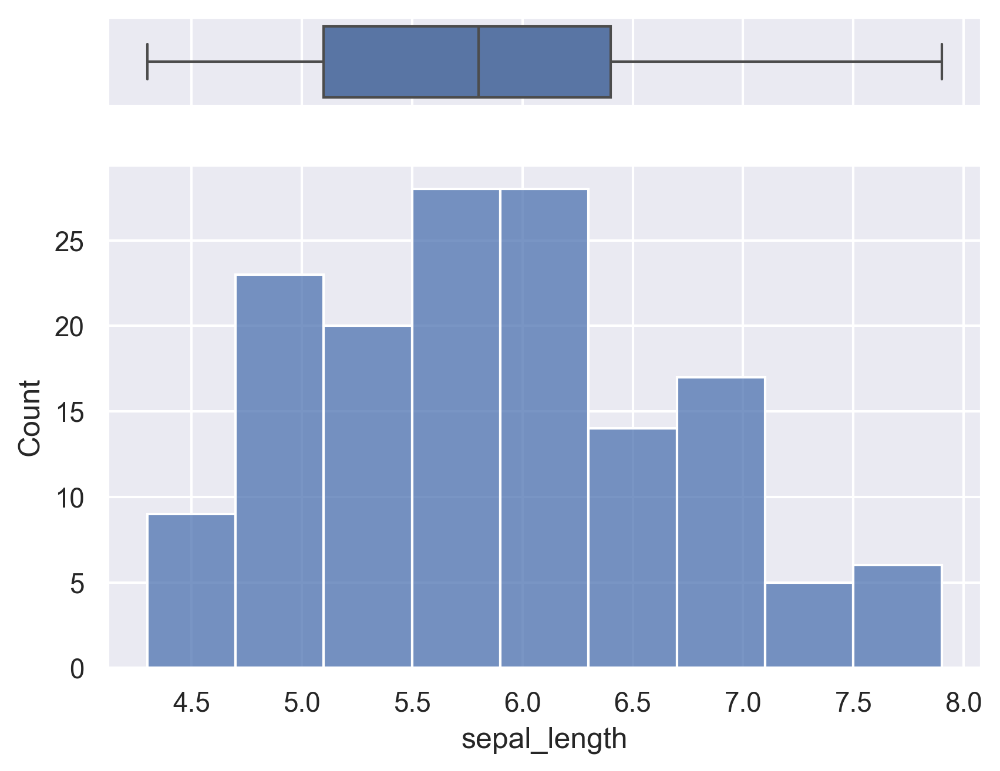

Adding a boxplot on top of a histogram can help you in better understanding the distribution of the data and visualizing outliers as well as quartiles positions. Note that we chose to use the histplot function below, though you could definitely use the `displot()` function also.

```python
# libraries & dataset
import seaborn as sns
import matplotlib.pyplot as plt
  
sns.set_theme(style="darkgrid")
df = sns.load_dataset("iris")
 
# creating a figure composed of two matplotlib.Axes objects (ax_box and ax_hist)
f, (ax_box, ax_hist) = plt.subplots(2, sharex=True, gridspec_kw={"height_ratios": (.15, .85)})
 
# assigning a graph to each ax
sns.boxplot(df["sepal_length"], orient="h", ax=ax_box)
sns.histplot(data=df, x="sepal_length", ax=ax_hist)
 
# Remove x axis name for the boxplot
ax_box.set(xlabel='')
plt.show()
```

:::output

:::
