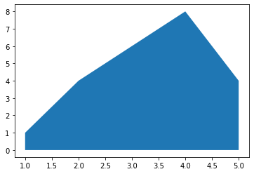

There are 2 main functions to draw a **basic area chart** using [matplotlib](http://python-graph-gallery.com/matplotlib/): `fill_between()` and `stackplot()` functions. I advise the `fill_between()` function which allows easier customisation. The `stackplot()` function also works, but it is more adapted for [stacked area charts](http://python-graph-gallery.com/stacked-area-plot/). The inputs are 2 numerical variables(x and y values) for both functions.

```python
# libraries
import numpy as np
import matplotlib.pyplot as plt
 
# Create data
x=range(1,6)
y=[1,4,6,8,4]
 
# Area plot
plt.fill_between(x, y)

# Show the graph
plt.show()
 
# Note that we could also use the stackplot function
# but fill_between is more convenient for future customization.
#plt.stackplot(x,y)
#plt.show()
```

:::output

:::
