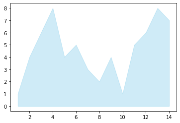
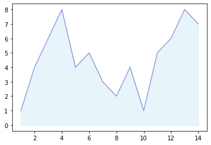
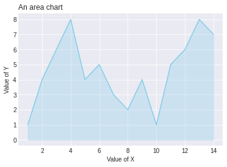

It is highly advised to change the default **color** of [matplotlib](http://python-graph-gallery.com/matplotlib/). Moreover, it is quite common to use a color with **transparency**, and **add a line** with a stronger colour on the top of the area.  

You can pass the `color` parameter to change the color of the area and the `alpha` parameter to change the color transparancy of the area to the `fill_between()` function. You can also add a line with the `plot()` function and change its color to make the edge of the area marked.

```python
# libraries
import numpy as np
import matplotlib.pyplot as plt
 
# create data
x=range(1,15)
y=[1,4,6,8,4,5,3,2,4,1,5,6,8,7]
 
# Change the color and its transparency
plt.fill_between( x, y, color="skyblue", alpha=0.4)

# Show the graph
plt.show()
 
# Same, but add a stronger line on top (edge)
plt.fill_between( x, y, color="skyblue", alpha=0.2)
plt.plot(x, y, color="Slateblue", alpha=0.6)
# See the line plot function to learn how to customize the plt.plot function

# Show the graph
plt.show()
```

:::output



:::

Last but not least, it is often worth it to change the **style** before doing your chart in order to plot a nice looking graph. Moreover, don’t forget to **add a title** and give **names to the axis**:

```python
# libraries
import numpy as np
import matplotlib.pyplot as plt
 
# create data
x=range(1,15)
y=[1,4,6,8,4,5,3,2,4,1,5,6,8,7]

# Change the style of plot
plt.style.use('seaborn-darkgrid')
 
# Make the same graph
plt.fill_between( x, y, color="skyblue", alpha=0.3)
plt.plot(x, y, color="skyblue")
 
# Add titles
plt.title("An area chart", loc="left")
plt.xlabel("Value of X")
plt.ylabel("Value of Y")

# Show the graph
plt.show()
```

:::output

:::
